# Tài liệu đặc tả yêu cầu phần mềm – Trợ lý AI quản lý lớp học THPT

| Mục | Nội dung |
| --- | --- |
| Tệp | `docs/tai-lieu-dac-ta.md` (bản Word: `docs/tai-lieu-dac-ta.docx`) |
| Phiên bản | 1.1, ngày 04/11/2026 |
| Đối chiếu mã nguồn | Commit `3012657`, nhánh `feat/nhap-giao-vien-tu-tep` |
| Khung tài liệu | ISO/IEC/IEEE 29148 (kế thừa IEEE 830), viết gọn |
| Người đọc | Giảng viên hướng dẫn, nhóm phát triển, người kiểm thử, nhà trường dùng thử |
| Tài liệu liên quan | [DESIGN.md](DESIGN.md) (thiết kế gốc), [FLOWS.md](FLOWS.md) (luồng), [DECISIONS.md](DECISIONS.md) (quyết định D-001…D-116), [PROGRESS.md](PROGRESS.md) (tiến độ), [PROMPTS.md](PROMPTS.md) (kế hoạch giai đoạn), `backend/ml/REPORT.md` (mô hình cảnh báo) |

<!-- toc -->

**Lịch sử phiên bản**

| Phiên bản | Ngày | Nội dung |
| --- | --- | --- |
| 1.0 | 04/11/2026 | `docs/SRS.md`: mô tả tổng quát, use case, yêu cầu chức năng, mô hình hành vi, dữ liệu, giao diện, phi chức năng, truy vết |
| 1.1 | 04/11/2026 | Tài liệu này: thêm quy tắc nghiệp vụ (BR), mức ưu tiên và cách kiểm chứng cho từng yêu cầu, nơi thực thi các ràng buộc, bảng API đủ 52 endpoint kèm vai trò, định dạng tệp nhập, chỗ lệch DESIGN – mã nguồn, vấn đề mở; thêm FR-ANA-12 |

Tài liệu mô tả **những gì hệ thống làm được ở thời điểm đối chiếu**. Mỗi yêu cầu có mã, mức ưu tiên, trạng thái, nguồn (mục DESIGN hoặc quyết định D-xxx) và cách kiểm chứng. Khi DESIGN.md và mã nguồn khác nhau, tài liệu theo mã nguồn và ghi chỗ lệch ở mục 11.2.

**Ký hiệu trạng thái:** ✅ Đã làm và có test · 🟡 Đã làm một phần hoặc còn hạn chế đã biết · ⬜ Chưa làm.

**Ký hiệu ưu tiên:** lấy theo cột Ưu tiên của DESIGN mục 2: Phải có · Nên có · Nếu còn thời gian. Phần làm thêm ngoài DESIGN theo yêu cầu của nhóm ghi "Nên có".

**Kiểm chứng:** đường dẫn tệp test tính từ `backend/tests/`; `eval/…` là bộ đánh giá. "Kiểm bằng tay" là phần giao diện chưa có test tự động (D-069), đã soát trên Chrome.

---

## 1. Giới thiệu

### 1.1 Mục đích

Đặc tả yêu cầu chức năng, quy tắc nghiệp vụ, dữ liệu, giao diện và yêu cầu phi chức năng của web app hỗ trợ trường THPT theo dõi điểm, chuyên cần, rèn luyện; cảnh báo sớm học sinh có nguy cơ không được lên lớp; hỏi đáp dữ liệu và quy định bằng tiếng Việt; sinh nhận xét và báo cáo bằng AI. Tài liệu dùng làm căn cứ nghiệm thu, viết test và đánh giá phạm vi đã làm so với thiết kế.

### 1.2 Phạm vi

- **Trong phạm vi:** một trường, nhiều năm học (đúng một năm hiện hành), ba khối 10–12, ba loại tài khoản (Giáo viên, Ban giám hiệu, Quản trị viên); GVCN và GVBM suy ra từ phân công. Dữ liệu vào bằng tệp Excel/CSV và nhập tay điểm. Công thức theo Thông tư 22/2021/TT-BGDĐT.
- **Ngoài phạm vi:** cổng phụ huynh và học sinh, đồng bộ với cơ sở dữ liệu ngành, ứng dụng di động, xếp thời khoá biểu, gửi email hay tin nhắn ra ngoài.
- **Dữ liệu:** chỉ dữ liệu giả lập (`data/seed/`, `data/samples/`). Không có dữ liệu thật hay khoá API trong mã nguồn.

### 1.3 Thuật ngữ và viết tắt

| Thuật ngữ | Nghĩa |
| --- | --- |
| GVBM | Giáo viên bộ môn: giáo viên có phân công dạy một cặp lớp–môn |
| GVCN | Giáo viên chủ nhiệm: giáo viên được gán làm chủ nhiệm một lớp trong một năm học |
| BGH | Ban giám hiệu (vai trò `principal`) |
| Admin | Quản trị viên / giáo vụ (vai trò `admin`) |
| ĐĐGtx, ĐĐGgk, ĐĐGck | Điểm đánh giá thường xuyên, giữa kỳ, cuối kỳ (`tx`, `gk`, `ck`) |
| ĐTBmhk, ĐTBmcn | Điểm trung bình môn học kỳ, cả năm |
| Môn nhận xét | Môn đánh giá bằng Đạt / Chưa đạt (Giáo dục thể chất, HĐTN-HN, GDĐP, Âm nhạc, Mĩ thuật) |
| Năm hiện hành | Năm học mặc định khi mở hệ thống (đúng một năm) |
| Bản nháp (`draft`) | Văn bản do AI sinh, chưa được giáo viên duyệt |
| RAG | Tìm đoạn văn bản quy định liên quan bằng vector rồi đưa cho LLM |
| Mã tạm | Mã `HS_01`, `HS_02`… thay họ tên và mã học sinh trước khi gửi LLM |
| BR, FR, NFR, UC | Quy tắc nghiệp vụ, yêu cầu chức năng, yêu cầu phi chức năng, use case |

### 1.4 Tài liệu tham chiếu

- Thông tư 22/2021/TT-BGDĐT quy định đánh giá học sinh trung học cơ sở và trung học phổ thông. Mã nguồn hiện dựa trên nguồn thứ cấp, cần đối chiếu văn bản gốc (mục 11.3).
- Chương trình giáo dục phổ thông 2018, cấp THPT: danh mục 17 môn và số tiết dùng trong `subjects`.
- ISO/IEC/IEEE 29148:2018 – Kỹ thuật yêu cầu (khung tài liệu).
- Các tài liệu nội bộ ở bảng đầu trang.

### 1.5 Tổng quan tài liệu

Mục 2 mô tả tổng quát sản phẩm và ràng buộc. Mục 3 là quy tắc nghiệp vụ (công thức Thông tư 22, luật cảnh báo, ràng buộc dữ liệu). Mục 4 là mô hình use case. Mục 5 là yêu cầu chức năng theo module. Mục 6 là mô hình hành vi. Mục 7 là yêu cầu dữ liệu. Mục 8 là giao diện ngoài. Mục 9 là yêu cầu phi chức năng. Mục 10 là ma trận truy vết. Mục 11 là hạn chế, chỗ lệch và vấn đề mở.

---

## 2. Mô tả tổng quát

### 2.1 Bối cảnh sản phẩm

Hệ thống ba tầng chạy bằng Docker Compose: front-end React, back-end FastAPI, PostgreSQL 16 + pgvector. LLM là dịch vụ bên ngoài (Anthropic, Gemini) hoặc chạy nội bộ (Ollama), chỉ được gọi từ hai module: Trợ lý AI và Nhận xét & báo cáo.

| Module back-end | Trách nhiệm |
| --- | --- |
| `auth` | Đăng nhập JWT, tài khoản, đổi mật khẩu, nhập giáo viên từ tệp, nhật ký truy cập |
| `classes` | Năm học, lớp, học sinh, môn, phân công, chọn năm học |
| `imports` | Nhập tệp (điểm, điểm danh, rèn luyện, danh sách học sinh), sửa / nhập tay điểm |
| `analytics` | **Nơi duy nhất** cài công thức Thông tư 22; dashboard lớp, bảng điểm môn, hồ sơ, tổng quan khối |
| `warning` | Cảnh báo sớm hai lớp: luật cứng + mô hình ML |
| `rag` | Nạp, tách Điều/Khoản, tìm kiếm văn bản quy định |
| `assistant` | Trợ lý hỏi đáp: LLM gọi 7 hàm chỉ đọc |
| `reports` | Sinh nhận xét / báo cáo nháp, kiểm, duyệt, xuất PDF |
| `core` | Cấu hình, DB, `authorize()`, ẩn danh, bảo mật |

### 2.2 Chức năng chính

1. Đăng nhập, phân quyền theo vai trò và phân công; bắt đổi mật khẩu tạm.
2. Quản trị: tài khoản, nhập giáo viên từ tệp, năm học (nhiều năm, lên lớp), lớp, GVCN, phân công, danh sách học sinh, văn bản quy định.
3. Nhập điểm, điểm danh, rèn luyện từ tệp có xem trước; sửa / nhập tay điểm từng học sinh kèm lịch sử.
4. Tính ĐTB, mức học tập, rèn luyện, điều kiện lên lớp theo Thông tư 22.
5. Dashboard lớp, bảng điểm môn (lọc theo khoảng điểm), hồ sơ học sinh, so sánh khối.
6. Cảnh báo sớm có lý do; GVCN ghi nhận xử lý; BGH xem toàn trường.
7. Trợ lý AI hỏi dữ liệu và quy định, có nguồn.
8. Sinh nhận xét môn, học bạ, phiếu liên lạc, báo cáo lớp / khối; duyệt; xuất PDF.

### 2.3 Người dùng và ma trận quyền

Vai trò lưu trong tài khoản là `teacher`, `principal`, `admin`. GVBM và GVCN **không phải loại tài khoản**: một giáo viên là GVBM của các cặp lớp–môn được phân công và là GVCN của lớp được gán; quyền cộng dồn và tính theo **năm học của lớp**.

| Dữ liệu / thao tác | GVBM | GVCN | BGH | Admin |
| --- | --- | --- | --- | --- |
| Bảng điểm môn của lớp | Môn được phân công | Mọi môn của lớp chủ nhiệm | Toàn trường | ✗ |
| Nhập điểm từ tệp, sửa / nhập tay điểm | Đúng lớp–môn | ✗ (trừ môn mình dạy) | ✗ | ✗ |
| Dashboard lớp, cảnh báo của lớp | ✗ | Lớp chủ nhiệm | Toàn trường | ✗ |
| Nhập điểm danh, rèn luyện | ✗ | Lớp chủ nhiệm | ✗ | ✗ |
| Ghi nhận cảnh báo ("đã trao đổi", "báo nhầm") | ✗ | Lớp chủ nhiệm | Chỉ xem | ✗ |
| Hồ sơ học sinh | Chỉ các môn mình dạy | Đầy đủ (kể cả phụ huynh) | Đầy đủ | ✗ |
| So sánh khối, cảnh báo toàn trường | ✗ | ✗ | ✓ | ✗ |
| Trợ lý AI | Phạm vi như trên | Phạm vi như trên | Phạm vi như trên | ✗ |
| Nhận xét môn | Đúng lớp–môn | – | – | ✗ |
| Học bạ, phiếu liên lạc, báo cáo lớp | – | Lớp chủ nhiệm | Xem, báo cáo lớp / khối | ✗ |
| Tài khoản, năm học, lớp, phân công, danh sách HS, văn bản quy định | ✗ | ✗ | ✗ | ✓ |

Admin **không xem dữ liệu học sinh** (D-039): màn hình quản trị chỉ có số đếm. Sai quyền trả 403 với cùng một thông điệp, không nêu lý do.

### 2.4 Môi trường vận hành

- Máy chủ: Docker Compose gồm 3 container (`db` pgvector/pg16, `backend` Python 3.12, `frontend` Vite). Không cần GPU.
- Trình duyệt: đã kiểm trên Chrome (desktop và khổ 390 px), có chế độ sáng / tối.
- Mạng ra ngoài: chỉ cần khi dùng LLM qua API và lần đầu tải mô hình embedding (khoảng 2,3 GB vào volume `hf_cache`).

### 2.5 Ràng buộc thiết kế (bất biến)

Tám nguyên tắc trong `CLAUDE.md`, áp dụng cho mọi yêu cầu bên dưới. Đường dẫn tính từ `backend/app/`.

| Mã | Ràng buộc | Nơi thực thi |
| --- | --- | --- |
| C1 | Code tính số liệu, LLM chỉ diễn giải. Mọi con số AI nói ra phải đến từ một hàm Analytics. | `assistant/grounding.py` (đối chiếu số trong câu trả lời), `reports/checks.py` (chặn bản nháp có số lạ) |
| C2 | Công thức Thông tư 22 chỉ nằm trong `analytics/`; hệ số và ngưỡng đọc từ bảng `settings`. | `analytics/config.py` (`load_config`); `warning/rules.py` chỉ dùng kết quả Analytics |
| C3 | LLM chỉ gọi đúng 7 hàm chỉ đọc; phạm vi (lớp, môn, khối, năm) lấy từ phiên và phân công, không từ tham số LLM điền. | `assistant/tools.py`, `assistant/scope.py` |
| C4 | Mọi endpoint và mọi tool đi qua `authorize(user, class_id, subject_id)`. | `core/authorize.py` (`authorize`, `authorize_write`, `authorize_admin`, `authorize_school`, `authorize_assistant`), `reports/permissions.py` |
| C5 | Trước khi gửi LLM: thay họ tên, mã HS bằng mã tạm; không bao giờ gửi ngày sinh, tên và số điện thoại phụ huynh. | `core/pseudonymize.py` (lớp `Pseudonymizer` thay tên bằng mã tạm; `assert_safe` chặn dữ liệu cấm trước mỗi lần gọi) |
| C6 | Văn bản AI sinh luôn ở `draft` tới khi giáo viên duyệt; không có đường nào gửi bản nháp ra ngoài. | `reports/` (xuất PDF bản nháp trả 409; không có chức năng gửi) |
| C7 | Chỉ dữ liệu giả lập; không commit dữ liệu thật hay khoá API. | `data/seed/`, `data/samples/`, `.gitignore`, `.env.example` |
| C8 | Không cần GPU. | Embedding `BAAI/bge-m3` chạy CPU (`rag/embedding.py`); mô hình ML scikit-learn |

### 2.6 Giả định và phụ thuộc

- Quy tắc Thông tư 22 lấy từ nguồn thứ cấp, **cần đối chiếu văn bản gốc** (D-047…D-055).
- Định dạng tệp xuất từ sổ điểm điện tử (VNEDU, SMAS…) là suy đoán; ánh xạ cột và tự dò dòng tiêu đề để bù (D-057).
- Chất lượng trả lời AI phụ thuộc nhà cung cấp LLM; gói miễn phí Gemini có giới hạn số yêu cầu mỗi phút / ngày (D-094).
- Mô hình cảnh báo ML huấn luyện trên dữ liệu giả lập; cần huấn luyện lại khi có dữ liệu thật.

---

## 3. Quy tắc nghiệp vụ

Các quy tắc dưới đây là **cách hiểu Thông tư 22 đang cài trong mã**. Mọi giá trị mặc định đọc từ bảng `settings` (nạp bằng migration), đổi được mà không sửa mã. Đường dẫn tính từ `backend/app/`.

### 3.1 Điểm trung bình môn

| Mã | Quy tắc | Khoá `settings` (mặc định) | Hiện thực |
| --- | --- | --- | --- |
| BR-01 | ĐTBmhk = (Tổng ĐĐGtx + 2 × ĐĐGgk + 3 × ĐĐGck) / (Số ĐĐGtx + 5). | `coef_midterm` (2), `coef_final` (3) | `analytics/scores.py` |
| BR-02 | ĐTBmcn = (ĐTBmhkI + 2 × ĐTBmhkII) / 3, tính từ hai ĐTB học kỳ đã làm tròn. | `coef_year_semester2` (2) | `analytics/scores.py` |
| BR-03 | Làm tròn nửa lên tới 1 chữ số thập phân (`ROUND_HALF_UP`). Mọi phép so ngưỡng dùng số đã làm tròn: 3,4 là dưới 3,5; 3,5 thì không. | – | `analytics/scores.py` |
| BR-04 | Số ĐĐGtx mỗi học kỳ theo số tiết/năm của môn: đến 35 tiết: 2; đến 70 tiết: 3; trên 70 tiết: 4 (ngưỡng tính cả biên). | `regular_assessment_count` | `analytics/thresholds.py` |
| BR-05 | ĐTB học kỳ khi còn thiếu đầu điểm chỉ là "tạm tính" (hiển thị dấu *), không dùng để xếp mức. | – | `analytics/scores.py` |
| BR-06 | Môn nhận xét chỉ có Đạt / Chưa đạt, không có ĐTB; kết quả cả năm là kết quả học kỳ II. | – | `analytics/conduct.py` |

### 3.2 Kết quả học tập, rèn luyện và lên lớp

| Mã | Quy tắc | Khoá `settings` (mặc định) | Hiện thực |
| --- | --- | --- | --- |
| BR-07 | Mức **Tốt**: mọi môn nhận xét Đạt; mọi môn điểm số từ 6,5; ít nhất 6 môn từ 8,0. | `score_threshold_fair` (6,5), `score_threshold_good` (8,0), `level_min_subjects` (6) | `analytics/learning.py` |
| BR-08 | Mức **Khá**: mọi môn nhận xét Đạt; mọi môn điểm số từ 5,0; ít nhất 6 môn từ 6,5. | `score_threshold_pass` (5,0), `score_threshold_fair`, `level_min_subjects` | `analytics/learning.py` |
| BR-09 | Mức **Đạt**: nhiều nhất 1 môn nhận xét Chưa đạt; ít nhất 6 môn điểm số từ 5,0; không môn nào dưới 3,5. Các trường hợp còn lại: **Chưa đạt**. | `score_threshold_fail` (3,5), `score_threshold_pass`, `level_min_subjects` | `analytics/learning.py` |
| BR-10 | Mức bị thấp hơn Tốt hoặc Khá từ 2 mức trở lên chỉ vì đúng một môn thì được nâng 1 mức (Điều 9). | `level_single_subject_adjustment` (bật) | `analytics/learning.py` |
| BR-11 | Chỉ xếp mức khi mọi môn đủ dữ liệu; thiếu thì để trống và nêu các môn còn thiếu. | – | `analytics/learning.py` |
| BR-12 | Rèn luyện cả năm: dùng bản ghi "cả năm" nếu giáo viên đã nhập; chưa có thì lấy học kỳ II và đánh dấu "suy ra". | – | `analytics/conduct.py` |
| BR-13 | Đủ điều kiện lên lớp khi học tập và rèn luyện cả năm từ Đạt trở lên và nghỉ không quá 45 buổi (45 vẫn đủ, 46 thì không) (Điều 12). Học tập hoặc rèn luyện đã Chưa đạt, hay nghỉ quá mức, thì kết luận "không đủ" ngay cả khi còn thiếu dữ liệu. | `max_absent_sessions` (45) | `analytics/promotion.py` |
| BR-14 | Môn có thể phải kiểm tra lại trong hè: môn điểm số có ĐTBmcn dưới 5,0; môn nhận xét Chưa đạt cả năm (Điều 14). | `score_threshold_pass` | `analytics/promotion.py` |

### 3.3 Cảnh báo sớm

Luật cứng nằm ở `warning/rules.py`, mô hình ML ở `warning/model.py`, phần gộp ở `warning/service.py`. Số buổi nghỉ là tổng buổi nghỉ có phép và không phép trong năm học.

| Mã | Luật | Điều kiện kích hoạt | Mức | Khoá `settings` |
| --- | --- | --- | --- | --- |
| BR-15 | `absent_over_limit` | Nghỉ quá 45 buổi | Cao | `max_absent_sessions` (45) |
| BR-16 | `absent_high` | Nghỉ từ 40 tới 45 buổi | Cao | `absent_warning_high` (40) |
| BR-17 | `absent_notice` | Nghỉ từ 30 tới 39 buổi | Trung bình | `absent_warning_notice` (30) |
| BR-18 | `level_fail` | Kết quả học tập của kỳ đang xét là Chưa đạt | Cao | – |
| BR-19 | `subject_below_fail` | Có môn ĐTB dưới 3,5 | Trung bình | `score_threshold_fail` |
| BR-20 | `few_subjects_pass` | Đã xếp được mức nhưng ít hơn 6 môn điểm số từ 5,0 | Trung bình | `level_min_subjects`, `score_threshold_pass` |
| BR-21 | `comment_fail_2plus` | Từ 2 môn nhận xét Chưa đạt trở lên | Trung bình | – (hằng trong `analytics/learning.py`) |
| BR-22 | `conduct_hk1_fail` | Rèn luyện học kỳ I Chưa đạt | Trung bình | – |
| BR-23 | `retake_risk` | Có môn có thể phải kiểm tra lại (BR-14) | Trung bình | `score_threshold_pass` |
| BR-24 | `grade12_exam_low` | Khối 12: môn đăng ký thi tốt nghiệp có ĐTB dưới 5,0 | Trung bình | `score_threshold_pass` |
| BR-25 | Mô hình ML | Random Forest dự báo xác suất học tập cả năm Chưa đạt, từ giữa học kỳ I: từ 0,54 là Trung bình, từ 0,80 là Cao; nêu tối đa 3 yếu tố làm tăng nguy cơ | Trung bình / Cao | – (ngưỡng trong `backend/ml/models/early-warning-rf-20261012.json`) |
| BR-26 | Mức cuối | Mức cao nhất giữa các luật và mô hình ML. Không luật nào kích hoạt và ML dưới ngưỡng: Thấp, không vào danh sách "cần hỗ trợ" | – | – |

Câu lý do chỉ nêu số liệu, không khẳng định "không thể đạt" (D-048), dùng từ trung tính "cần hỗ trợ" và không có họ tên.

### 3.4 Ràng buộc dữ liệu và giới hạn

| Mã | Quy tắc | Hiện thực |
| --- | --- | --- |
| BR-27 | Điểm số trong khoảng 0–10, tối đa 1 chữ số thập phân, không tự làm tròn; nhận cả `7,5` và `7.5`. | `imports/values.py`, `imports/validation.py`, `imports/manual.py` |
| BR-28 | Mỗi đầu điểm có đúng một trong hai: điểm số hoặc Đạt / Chưa đạt; khoá duy nhất theo lớp-học sinh, môn, học kỳ, loại, thứ tự. | Ràng buộc `CHECK` và khoá duy nhất trong DB |
| BR-29 | Mỗi học sinh thuộc một lớp mỗi năm học; mỗi cặp lớp–môn một giáo viên; mỗi giáo viên chủ nhiệm tối đa một lớp mỗi năm; tên lớp không trùng trong một năm. | `classes/`, ràng buộc DB |
| BR-30 | Đúng một năm hiện hành; các năm học không chồng ngày; ngày điểm danh phải nằm trong năm học của lớp. | `classes/admin_service.py`, `imports/validation.py` |
| BR-31 | Trợ lý AI: tối đa 10 câu hỏi mỗi phút mỗi tài khoản (biến môi trường `ASSISTANT_RATE_PER_MINUTE`); tối đa 4 vòng gọi hàm mỗi câu hỏi. | `assistant/service.py`, `core/config.py` |
| BR-32 | RAG lấy 4 đoạn gần nhất và bỏ các đoạn có độ tương đồng dưới 0,56 (`rag_min_similarity`); văn bản hết hiệu lực không bao giờ được trích. | `rag/search.py` |

---

## 4. Mô hình use case

### 4.1 Tác nhân

| Tác nhân | Loại | Mô tả |
| --- | --- | --- |
| Người dùng | Trừu tượng | Mọi người có tài khoản; dùng chung đăng nhập, đổi mật khẩu, chọn năm học |
| Giáo viên | Chính | Tài khoản vai trò `teacher`. Là GVBM của các cặp lớp–môn được phân công và là GVCN của lớp được gán; quyền cộng dồn, tính theo năm học |
| Giáo viên bộ môn (GVBM) | Chính | Nhập, sửa điểm môn mình dạy; xem bảng điểm, hồ sơ (môn mình); sinh nhận xét môn |
| Giáo viên chủ nhiệm (GVCN) | Chính | Xem dashboard, cảnh báo, hồ sơ đầy đủ của lớp chủ nhiệm; nhập điểm danh, rèn luyện; sinh học bạ, phiếu liên lạc, báo cáo lớp |
| Ban giám hiệu (BGH) | Chính | Xem toàn trường, so sánh khối, cảnh báo toàn trường; sinh, duyệt báo cáo lớp / khối; không nhập dữ liệu |
| Quản trị viên (Admin) | Chính | Tài khoản, năm học, lớp, phân công, danh sách học sinh, văn bản quy định; không xem dữ liệu học sinh |
| Dịch vụ LLM | Phụ (hệ thống ngoài) | Anthropic / Gemini / Ollama; chỉ nhận dữ liệu đã ẩn danh, chỉ được yêu cầu 7 hàm chỉ đọc |

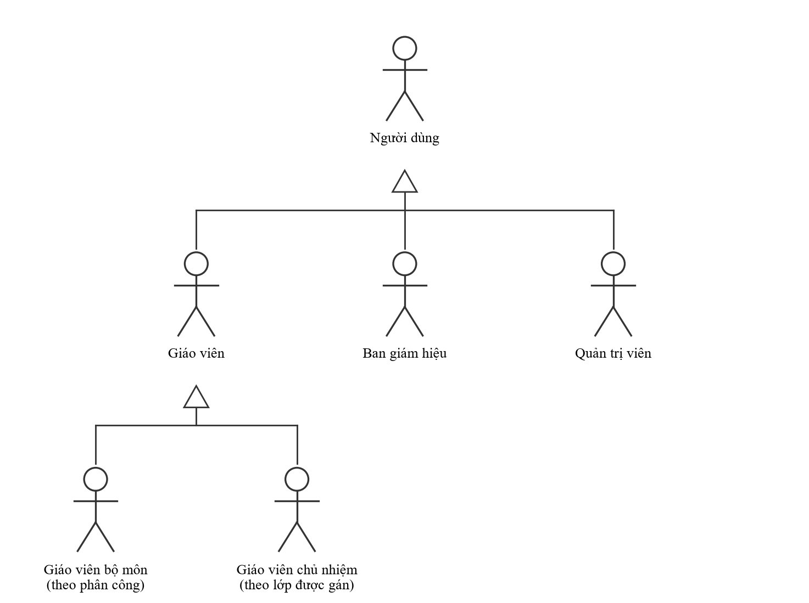

### 4.2 Sơ đồ use case tổng quát

Trong sơ đồ tổng quát, "Giáo viên" đại diện cho cả GVBM và GVCN; use case nào chỉ dành cho một trong hai được ghi ở bảng 4.3 và ở các sơ đồ phân rã.

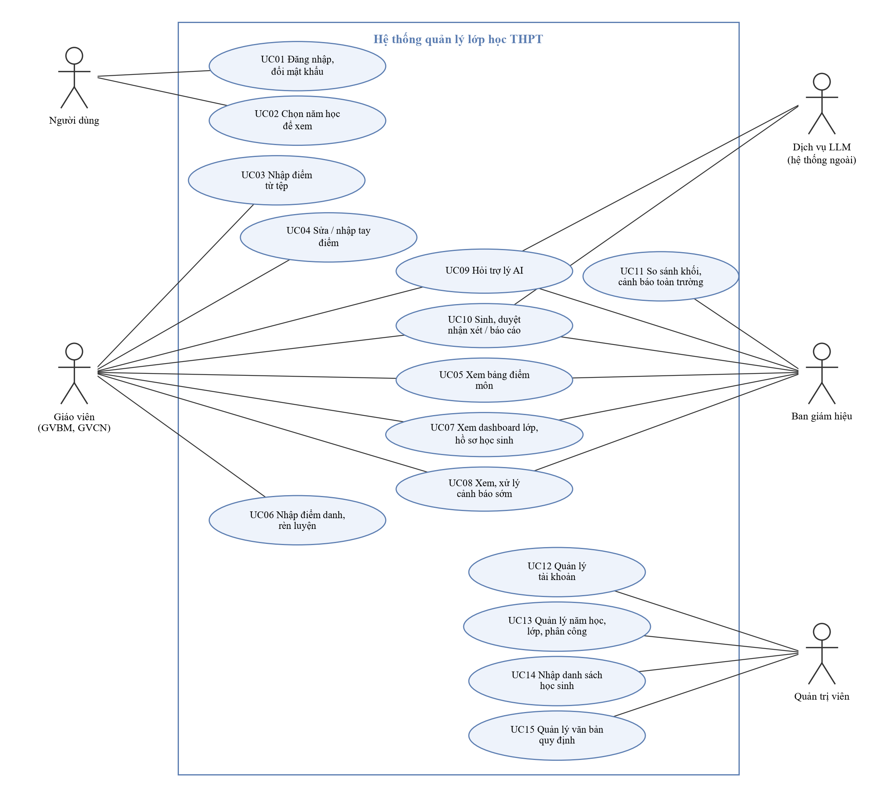

### 4.3 Danh sách use case

| Mã | Tên use case | Tác nhân | Mô tả ngắn | Yêu cầu |
| --- | --- | --- | --- | --- |
| UC01 | Đăng nhập, đổi mật khẩu | Người dùng | Đăng nhập JWT; bắt đặt mật khẩu mới khi dùng mật khẩu tạm; tự đổi mật khẩu | FR-AUTH-01…05 |
| UC02 | Chọn năm học để xem | Người dùng (Admin dùng ở trang quản trị) | Chọn năm trên thanh trên cùng; mọi trang xem theo năm đó | FR-YEAR-01…03 |
| UC03 | Nhập điểm từ tệp | GVBM | Tải tệp điểm một môn, một học kỳ; xem trước; xác nhận | FR-IMP-01…07 |
| UC04 | Sửa / nhập tay điểm | GVBM | Sửa vài đầu điểm của một học sinh, bắt chọn lý do, lưu lịch sử | FR-SCORE-01…04 |
| UC05 | Xem bảng điểm môn | GVBM, GVCN, BGH | Lưới điểm, ĐTB, phân bố, lọc theo khoảng điểm, lịch sử sửa | FR-ANA-07, FR-ANA-08 |
| UC06 | Nhập điểm danh, rèn luyện | GVCN | Tải tệp điểm danh / rèn luyện của lớp chủ nhiệm | FR-IMP-01…07 |
| UC07 | Xem dashboard lớp, hồ sơ học sinh | GVCN, BGH (GVBM: hồ sơ môn mình) | Số liệu lớp theo Thông tư 22, hồ sơ từng em | FR-ANA-06, FR-ANA-09 |
| UC08 | Xem, xử lý cảnh báo sớm | GVCN (ghi nhận), BGH (xem) | Danh sách học sinh cần hỗ trợ kèm lý do; ghi nhận đã trao đổi / báo nhầm | FR-WARN-01…05 |
| UC09 | Hỏi trợ lý AI | Giáo viên, BGH; Dịch vụ LLM | Hỏi dữ liệu và quy định bằng tiếng Việt, có nguồn | FR-AI-01…06, FR-RAG-02 |
| UC10 | Sinh, duyệt nhận xét / báo cáo | GVBM, GVCN, BGH; Dịch vụ LLM | Sinh bản nháp, kiểm, sửa, duyệt, xuất PDF | FR-RPT-01…06 |
| UC11 | So sánh khối, cảnh báo toàn trường | BGH | So sánh các lớp trong khối, học kỳ I và II mọi môn; cảnh báo mức cao | FR-ANA-10, FR-WARN-05 |
| UC12 | Quản lý tài khoản | Admin | Tạo, sửa, đặt lại mật khẩu, khoá / mở khoá; nhập giáo viên từ tệp | FR-ADM-01…04 |
| UC13 | Quản lý năm học, lớp, phân công | Admin | Năm học, năm hiện hành, lên lớp; lớp, GVCN; phân công giảng dạy | FR-ADM-05…08 |
| UC14 | Nhập danh sách học sinh | Admin | Nhập / gỡ học sinh của một lớp | FR-ADM-09 |
| UC15 | Quản lý văn bản quy định | Admin | Tải văn bản, tách Điều/Khoản, đổi hiệu lực | FR-ADM-10, FR-RAG-01…03 |

### 4.4 Sơ đồ use case phân rã

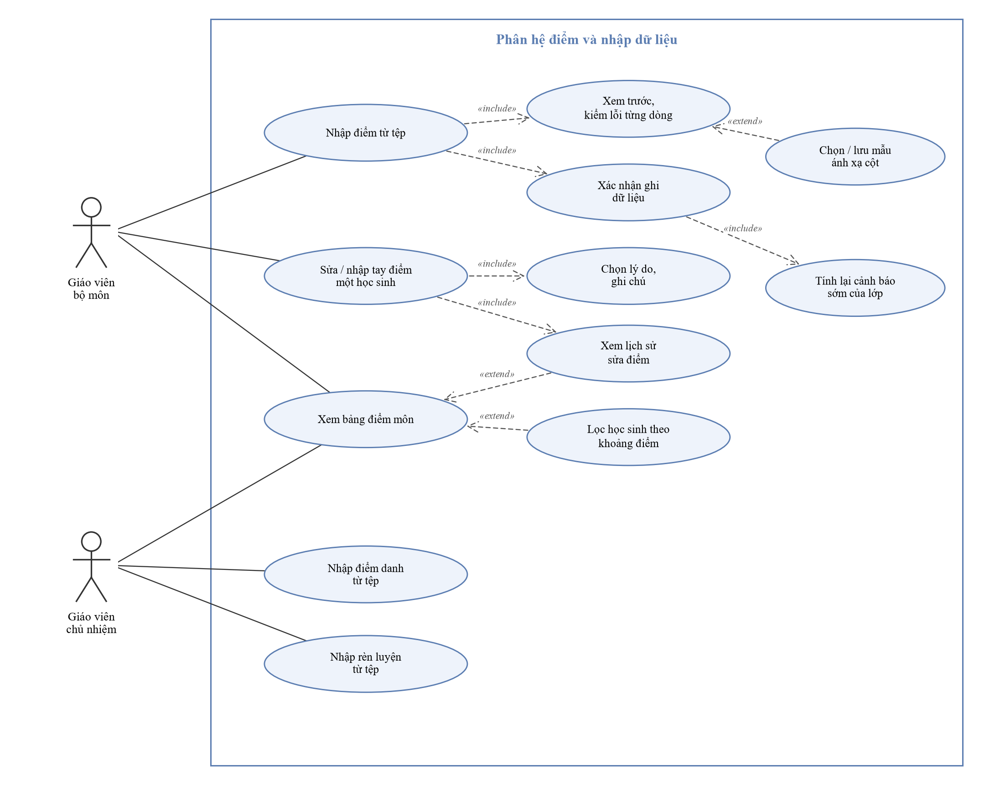

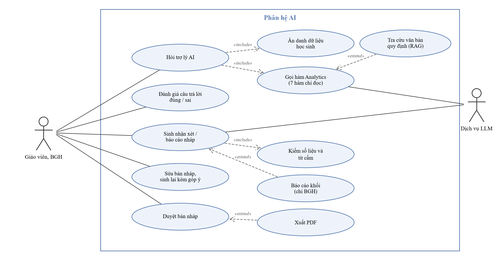

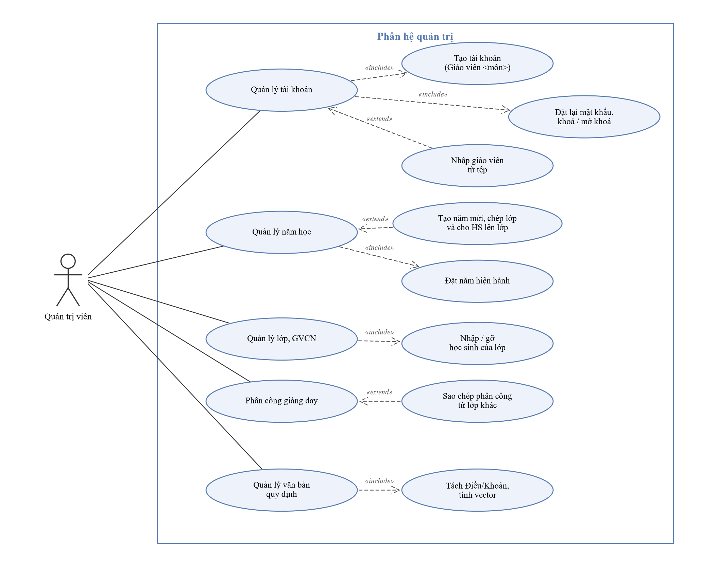

### 4.5 Đặc tả use case

**Bảng 4.1 – UC01 Đăng nhập, đổi mật khẩu**

| Mục | Nội dung |
| --- | --- |
| Tác nhân | Người dùng (mọi vai trò) |
| Mô tả | Xác thực bằng email và mật khẩu, nhận JWT; nếu đang dùng mật khẩu tạm thì bắt đặt mật khẩu riêng trước khi dùng hệ thống |
| Tiền điều kiện | Tài khoản đã được Admin tạo và đang hoạt động |
| Luồng chính | 1. Người dùng nhập email, mật khẩu. 2. Hệ thống tìm tài khoản theo email (không phân biệt hoa thường), so mật khẩu băm bcrypt, kiểm tài khoản đang hoạt động. 3. Hệ thống cấp JWT (hạn 120 phút). 4. Hệ thống đọc cờ `must_change_password`: không bật. 5. Hệ thống hiện trang chủ và thanh bên theo vai trò, phân công của năm đang xem. |
| Luồng thay thế | 4a. Cờ bật (mật khẩu tạm): hiện màn hình "Đặt mật khẩu của riêng bạn"; người dùng nhập mật khẩu tạm và mật khẩu mới (≥ 8 ký tự, khác mật khẩu tạm); hệ thống lưu, tắt cờ, ghi nhật ký; tiếp bước 5. 5a. Người dùng tự đổi mật khẩu ở menu người dùng: nhập mật khẩu hiện tại và mật khẩu mới. |
| Ngoại lệ | 2a. Sai email, sai mật khẩu hoặc tài khoản bị khoá: 401 với cùng một thông điệp "Email hoặc mật khẩu không đúng." 4a1. Mật khẩu tạm nhập sai hoặc mật khẩu mới không hợp lệ: báo lỗi, giữ màn hình đặt mật khẩu. Mọi API khác vẫn trả 403. |
| Hậu điều kiện | Phiên đăng nhập hợp lệ; lần đổi mật khẩu được ghi `audit_logs` |

**Bảng 4.2 – UC02 Chọn năm học để xem**

| Mục | Nội dung |
| --- | --- |
| Tác nhân | Người dùng |
| Mô tả | Chọn năm học đang xem trên thanh trên cùng; mọi trang hiển thị dữ liệu của năm đó |
| Tiền điều kiện | Đã đăng nhập; trường có từ hai năm học |
| Luồng chính | 1. Người dùng chọn năm ở ô "Năm học". 2. Hệ thống lưu lựa chọn trong trình duyệt và nạp lại trang chủ, thanh bên, so sánh khối, cảnh báo, báo cáo khối, trợ lý AI theo năm đó. 3. Nếu không phải năm hiện hành, hiện dải báo kèm nút "Về năm hiện hành". |
| Luồng thay thế | 2a. Đang mở trang một lớp: hệ thống chuyển về trang chủ (lớp gắn với một năm cụ thể). |
| Ngoại lệ | Năm không tồn tại: 404. |
| Hậu điều kiện | Quyền xem dữ liệu năm cũ theo phân công của chính năm đó |

**Bảng 4.3 – UC03 Nhập điểm từ tệp**

| Mục | Nội dung |
| --- | --- |
| Tác nhân | Giáo viên bộ môn |
| Mô tả | Nhập điểm một lớp, một môn, một học kỳ từ tệp Excel/CSV, có xem trước trước khi ghi |
| Tiền điều kiện | Giáo viên được phân công đúng lớp–môn; lớp đã có danh sách học sinh |
| Luồng chính | 1. Giáo viên chọn môn, học kỳ, kéo thả tệp. 2. Hệ thống kiểm quyền ghi trước khi đọc tệp. 3. Hệ thống đọc tệp, tự dò dòng tiêu đề, ánh xạ cột (mẫu đã lưu hoặc bí danh). 4. Hệ thống kiểm từng dòng và hiện bản xem trước (Mới / Đổi cũ → mới / Giữ nguyên / Lỗi / Cảnh báo). 5. Giáo viên bấm "Xác nhận nhập". 6. Hệ thống ghi trong một transaction, ghi nhật ký, rồi tính lại cảnh báo sớm của lớp. |
| Luồng thay thế | 3a. Thiếu cột bắt buộc: giáo viên chọn cột tương ứng (có thể lưu thành mẫu), quay lại bước 3. 4a. Bật "Cho phép nhập dở": thiếu đầu điểm thành cảnh báo, ô trống không ghi. |
| Ngoại lệ | 2a. Không có phân công: 403. 3b. Tệp sai định dạng, quá 5 MB: 413 / 415 / 422. 4b. Có dòng lỗi (điểm ngoài 0–10, quá 1 chữ số thập phân, mã HS không thuộc lớp, trùng): không cho xác nhận. 5a. Bản xem trước quá 24 giờ: 410, phải tải lại. |
| Hậu điều kiện | Điểm được ghi (ô trống không xoá điểm cũ, nhập lại không nhân đôi); cảnh báo của lớp được cập nhật |

**Bảng 4.4 – UC04 Sửa / nhập tay điểm**

| Mục | Nội dung |
| --- | --- |
| Tác nhân | Giáo viên bộ môn |
| Mô tả | Sửa vài đầu điểm của một học sinh (kiểm tra lại, kiểm tra bù, nhập sai) mà không tải lại cả tệp |
| Tiền điều kiện | Giáo viên được phân công đúng lớp–môn; đang mở Bảng điểm môn ở học kỳ cần sửa |
| Luồng chính | 1. Giáo viên bấm "Sửa" ở dòng học sinh. 2. Hệ thống hiện các ô TX1…TXn, Giữa kỳ, Cuối kỳ (môn nhận xét: Đạt / Chưa đạt) và lịch sử sửa. 3. Giáo viên sửa ô cần đổi (ô đổi được làm nổi), chọn lý do, ghi chú. 4. Hệ thống kiểm giá trị, ghi các ô đổi, thêm lịch sử cũ → mới, ghi nhật ký `edit_scores`. 5. ĐTB và cảnh báo sớm tính lại; hộp thoại báo "Đã lưu n đầu điểm". |
| Luồng thay thế | 3a. Ô đang thiếu: nhập mới (kiểm tra bù), lịch sử ghi "thiếu → điểm". |
| Ngoại lệ | 3b. Lý do "Khác" không có ghi chú, điểm ngoài 0–10 hoặc quá 1 chữ số thập phân, xoá trắng ô đã có: không cho lưu. 4a. Không ô nào đổi giá trị: 400 "Không có điểm nào thay đổi." 4b. Không có phân công (GVCN, BGH): chỉ xem lịch sử, không sửa (403 nếu gọi thẳng API). |
| Hậu điều kiện | Điểm mới thay hẳn điểm cũ; điểm cũ còn trong `assessment_changes` |

**Bảng 4.5 – UC05 Xem bảng điểm môn**

| Mục | Nội dung |
| --- | --- |
| Tác nhân | GVBM (môn mình), GVCN (lớp chủ nhiệm), BGH |
| Mô tả | Xem lưới đầu điểm, ĐTB học kỳ và cả năm, phân bố điểm của một môn trong lớp |
| Tiền điều kiện | Đã đăng nhập; có quyền với lớp–môn |
| Luồng chính | 1. Người dùng mở lớp → môn, chọn học kỳ. 2. Hệ thống kiểm quyền, tính ĐTB bằng Analytics, ghi nhật ký xem. 3. Hệ thống hiện sĩ số, ĐTB lớp, số em thiếu đầu điểm, phân bố, lưới điểm (ô thiếu tô đỏ, ĐTB tạm tính có dấu *). |
| Luồng thay thế | 3a. Lọc theo khoảng ĐTB (dưới 3,5; 3,5–<5,0; 5,0–<6,5; 6,5–<8,0; từ 8,0) theo học kỳ hoặc cả năm, hoặc "còn thiếu đầu điểm". 3b. Bấm "Lịch sử" (GVCN, BGH) hoặc "Sửa" (GVBM, sang UC04). |
| Ngoại lệ | Không có quyền: 403. Lớp không học môn: 404. |
| Hậu điều kiện | Không đổi dữ liệu; có dòng nhật ký `view_subject_scores` |

**Bảng 4.6 – UC06 Nhập điểm danh, rèn luyện**

| Mục | Nội dung |
| --- | --- |
| Tác nhân | Giáo viên chủ nhiệm |
| Mô tả | Nhập điểm danh (dạng dài: mã HS, ngày, trạng thái) hoặc rèn luyện (mã HS, mức, nhận xét; kỳ HK1 / HK2 / cả năm) của lớp chủ nhiệm |
| Tiền điều kiện | Là GVCN của lớp trong năm học của lớp |
| Luồng chính | Như UC03; bước 1 chọn loại "Điểm danh" hoặc "Rèn luyện" (rèn luyện chọn thêm kỳ). |
| Ngoại lệ | Ngày ngoài năm học của lớp, trạng thái hay mức lạ, trùng học sinh + ngày: dòng lỗi. Không phải GVCN: 403. |
| Hậu điều kiện | Dữ liệu được ghi; cảnh báo sớm (số buổi nghỉ) được cập nhật |

**Bảng 4.7 – UC07 Xem dashboard lớp, hồ sơ học sinh**

| Mục | Nội dung |
| --- | --- |
| Tác nhân | GVCN, BGH (hồ sơ: thêm GVBM, chỉ các môn mình dạy) |
| Mô tả | Xem tình hình học tập, rèn luyện, chuyên cần của lớp và của từng học sinh |
| Tiền điều kiện | Có quyền với lớp; dữ liệu đã nhập |
| Luồng chính | 1. Người dùng mở lớp, chọn kỳ (HK1 / HK2 / cả năm). 2. Hệ thống hiện sĩ số, phân bố mức học tập, số em nghỉ nhiều, số cảnh báo, ĐTB các môn, điều kiện lên lớp, nghỉ theo tháng, danh sách học sinh cần hỗ trợ. 3. Người dùng mở hồ sơ một em: ĐTB từng môn, mức, rèn luyện, chuyên cần, cảnh báo và lý do, thông tin phụ huynh. |
| Luồng thay thế | 3a. GVBM mở hồ sơ: chỉ thấy các môn mình dạy, không có xếp loại, chuyên cần, phụ huynh. |
| Ngoại lệ | GVBM mở dashboard lớp: 403. Mức học tập để trống khi chưa đủ dữ liệu (ghi rõ môn thiếu). |
| Hậu điều kiện | Nhật ký `view_class_dashboard` / `view_student_profile` |

**Bảng 4.8 – UC08 Xem, xử lý cảnh báo sớm**

| Mục | Nội dung |
| --- | --- |
| Tác nhân | GVCN (ghi nhận), BGH (chỉ xem) |
| Mô tả | Xem học sinh cần hỗ trợ (mức Cao / Trung bình) kèm lý do theo Thông tư 22 và mô hình dự báo; GVCN ghi nhận cách xử lý |
| Tiền điều kiện | Cảnh báo đã được tính (sau mỗi lần dữ liệu đổi hoặc `make warn`) |
| Luồng chính | 1. GVCN mở dashboard lớp, mục "Học sinh cần hỗ trợ". 2. Hệ thống hiện mức, ba lý do hàng đầu, trạng thái. 3. GVCN đọc lý do, trao đổi với học sinh / phụ huynh ngoài hệ thống. 4. GVCN ghi nhận "Đã trao đổi". |
| Luồng thay thế | 4a. GVCN đánh dấu "Báo nhầm" (dùng để đánh giá lại mô hình) hoặc đặt lại "Mới". |
| Ngoại lệ | Cảnh báo đã bị dòng mới thay thế: 409. BGH, GVBM ghi nhận: 403. |
| Hậu điều kiện | `teacher_status` được lưu, nhật ký `update_alert`; cảnh báo không tự gửi cho học sinh hay phụ huynh |

**Bảng 4.9 – UC09 Hỏi trợ lý AI**

| Mục | Nội dung |
| --- | --- |
| Tác nhân | Giáo viên, BGH; Dịch vụ LLM (phụ) |
| Mô tả | Hỏi số liệu và quy định bằng tiếng Việt; câu trả lời có nguồn |
| Tiền điều kiện | Đã cấu hình `LLM_PROVIDER`; người hỏi không phải Admin; chưa vượt 10 câu/phút |
| Luồng chính | 1. Người dùng gõ câu hỏi trong khung chat (hệ thống biết lớp, môn, kỳ, năm đang xem). 2. Hệ thống kiểm quyền, ẩn danh họ tên và mã HS thành `HS_xx`. 3. LLM chọn trong 7 hàm chỉ đọc; mỗi hàm qua `authorize()` rồi gọi Analytics hoặc RAG (tối đa 4 vòng). 4. LLM viết câu trả lời từ kết quả hàm. 5. Hệ thống đối chiếu mọi con số với kết quả hàm, đổi mã tạm về tên, lưu `ai_logs`, hiện câu trả lời và mục Nguồn. |
| Luồng thay thế | 3a. Câu hỏi về quy định: gọi `search_regulation`; không tìm thấy đoạn đủ liên quan thì trả lời "Không tìm thấy trong văn bản quy định". 5a. Người dùng đánh giá câu trả lời đúng / sai. |
| Ngoại lệ | 3b. Hàm đòi dữ liệu ngoài quyền: kết quả `forbidden`, LLM phải nói không có quyền. 5b. Có số không đối chiếu được: hiện cảnh báo vàng. Vượt giới hạn: 429. Chưa cấu hình LLM: 503. Lỗi nhà cung cấp: 502. |
| Hậu điều kiện | Không ghi dữ liệu nghiệp vụ; `ai_logs` lưu bản đã ẩn danh |

**Bảng 4.10 – UC10 Sinh, duyệt nhận xét / báo cáo**

| Mục | Nội dung |
| --- | --- |
| Tác nhân | GVBM (nhận xét môn), GVCN (học bạ, phiếu liên lạc, báo cáo lớp), BGH (báo cáo lớp / khối); Dịch vụ LLM (phụ) |
| Mô tả | AI viết bản nháp từ số liệu Analytics; giáo viên sửa, duyệt, xuất PDF |
| Tiền điều kiện | Có quyền với lớp / môn / khối; đã cấu hình LLM |
| Luồng chính | 1. Giáo viên chọn lớp, loại, kỳ; bấm sinh cho một em hoặc cả lớp. 2. Hệ thống lấy số liệu (không họ tên, mã HS, ngày sinh, phụ huynh), gửi LLM theo nhóm tối đa 5 em. 3. Hệ thống kiểm số liệu và từ cấm; đạt thì lưu bản nháp. 4. Giáo viên đọc, sửa, bấm "Duyệt". 5. Giáo viên xuất PDF (phiếu liên lạc có họ tên thật lấy từ DB). |
| Luồng thay thế | 1a. Sinh cả lớp chạy nền, giao diện hiện tiến độ; dừng giữa chừng thì gửi lại để tiếp tục. 4a. "Sinh lại kèm góp ý" (≤ 300 ký tự) cho bản nháp. 4b. Sửa bản đã duyệt: bản trở về nháp. |
| Ngoại lệ | 3a. Không đạt sau 2 lần viết lại: đánh dấu "cần tự viết", giáo viên tự viết. Văn bản giáo viên viết có từ cấm: cảnh báo nhưng vẫn cho lưu. Không có quyền: 403. |
| Hậu điều kiện | Bản AI sinh luôn ở trạng thái nháp tới khi duyệt; nhật ký không chứa văn bản nhận xét |

**Bảng 4.11 – UC11 So sánh khối, cảnh báo toàn trường**

| Mục | Nội dung |
| --- | --- |
| Tác nhân | Ban giám hiệu |
| Mô tả | So sánh các lớp trong khối và xem cảnh báo mức cao toàn trường của năm đang xem |
| Tiền điều kiện | Đăng nhập vai trò BGH |
| Luồng chính | 1. BGH mở "Khối 10 / 11 / 12", chọn kỳ. 2. Hệ thống hiện số liệu gộp theo lớp (mức học tập, rèn luyện, chuyên cần, số em có môn dưới 3,5). 3. Mục "Học kỳ I so với học kỳ II": chọn môn (mọi môn của khối); môn lựa chọn chỉ so các lớp học môn đó, môn nhận xét so số học sinh Chưa đạt. 4. Trang chủ BGH hiện cảnh báo mức cao toàn trường. |
| Ngoại lệ | Giáo viên, Admin: 403. Khối không có lớp: 404. |
| Hậu điều kiện | Chỉ số liệu gộp, không có tên học sinh ở so sánh khối |

**Bảng 4.12 – UC12 Quản lý tài khoản**

| Mục | Nội dung |
| --- | --- |
| Tác nhân | Quản trị viên |
| Mô tả | Tạo, sửa, đặt lại mật khẩu, khoá / mở khoá tài khoản; nhập nhiều giáo viên từ tệp |
| Tiền điều kiện | Đăng nhập vai trò Admin |
| Luồng chính | 1. Admin nhập họ tên, email, vai trò ("Giáo viên <môn>", BGH, Admin), ghi chú. 2. Hệ thống kiểm email chưa dùng, tạo tài khoản với mật khẩu tạm ngẫu nhiên, bật cờ bắt đổi mật khẩu. 3. Hệ thống hiện mật khẩu tạm một lần để Admin đưa cho người dùng. |
| Luồng thay thế | 1a. Nhập từ tệp: xem trước, có dòng lỗi (email trùng, sai định dạng) thì không tạo gì; xác nhận thì hiện bảng mật khẩu tạm và nút tải CSV. 1b. Sửa, đặt lại mật khẩu, khoá / mở khoá trong hộp thoại; tài khoản đã khoá nằm ở danh sách riêng. |
| Ngoại lệ | Email trùng: 409. Tự khoá hoặc tự hạ vai trò của chính mình: từ chối. Đổi vai trò giáo viên đang có phân công năm hiện hành: từ chối. |
| Hậu điều kiện | Nhật ký quản trị; mật khẩu chỉ lưu bản băm |

**Bảng 4.13 – UC13 Quản lý năm học, lớp, phân công**

| Mục | Nội dung |
| --- | --- |
| Tác nhân | Quản trị viên |
| Mô tả | Tạo năm học (kèm chép lớp, lên lớp), đặt năm hiện hành; tạo lớp, gán GVCN; phân công giáo viên cho từng lớp–môn |
| Tiền điều kiện | Đăng nhập vai trò Admin |
| Luồng chính | 1. Admin tạo năm học mới (tên, ngày); tuỳ chọn chép lớp và cho học sinh lên lớp, đặt làm năm hiện hành. 2. Admin tạo / sửa lớp, chọn GVCN. 3. Admin mở lớp, chọn giáo viên cho từng môn ("Giáo viên <môn đó>" được đưa lên đầu). |
| Luồng thay thế | 3a. Sao chép phân công từ lớp khác cùng khối, cùng năm (chỉ điền môn còn trống). |
| Ngoại lệ | Trùng tên năm hoặc chồng ngày; trùng tên lớp trong năm; giáo viên đã chủ nhiệm lớp khác cùng năm; gỡ phân công khi lớp đã có điểm môn đó: từ chối. |
| Hậu điều kiện | Quyền GVBM / GVCN thay đổi ngay theo phân công mới |

**Bảng 4.14 – UC14 Nhập danh sách học sinh**

| Mục | Nội dung |
| --- | --- |
| Tác nhân | Quản trị viên |
| Mô tả | Nhập học sinh của một lớp từ tệp; gỡ học sinh nhập nhầm |
| Tiền điều kiện | Lớp đã tồn tại |
| Luồng chính | 1. Admin mở lớp, tải tệp (Mã HS, Họ và tên bắt buộc; Ngày sinh, Phụ huynh, Số điện thoại tuỳ chọn). 2. Hệ thống xem trước, kiểm từng dòng. 3. Admin xác nhận; mã đã có thì gắn vào lớp và cập nhật thông tin. |
| Luồng thay thế | 1a. Gỡ học sinh: Admin gõ mã; chỉ gỡ được khi em chưa có điểm, điểm danh, rèn luyện, cảnh báo. |
| Ngoại lệ | Học sinh đã thuộc lớp khác cùng năm: dòng lỗi. Ngày sinh bất thường: cảnh báo. |
| Hậu điều kiện | Admin không xem được danh sách học sinh (chỉ số đếm) |

**Bảng 4.15 – UC15 Quản lý văn bản quy định**

| Mục | Nội dung |
| --- | --- |
| Tác nhân | Quản trị viên |
| Mô tả | Nạp văn bản quy định cho RAG và quản lý hiệu lực |
| Tiền điều kiện | Mô hình embedding đã tải |
| Luồng chính | 1. Admin nhập tên, tải PDF / DOCX / TXT. 2. Hệ thống tách theo Điều / Khoản, tính vector, ghi văn bản và các đoạn trong một transaction. 3. Admin thử tìm ở ô "Thử tìm". |
| Luồng thay thế | 3a. Đánh dấu hết hiệu lực / bật lại; văn bản hết hiệu lực không bao giờ được trích. |
| Ngoại lệ | Trùng tên văn bản còn hiệu lực: 409. PDF quét ảnh (không có lớp chữ): từ chối. Không nạp được mô hình: 503. |
| Hậu điều kiện | Trợ lý AI tìm được văn bản mới |

---

## 5. Yêu cầu chức năng

Mỗi yêu cầu được hiểu là "Hệ thống phải …". Dòng **Kiểm chứng** trong ô yêu cầu chỉ tệp test hoặc bộ đánh giá chứng minh yêu cầu.

### 5.1 Xác thực và tài khoản (`auth`)

| Mã | Yêu cầu | Ưu tiên | Trạng thái | Nguồn |
| --- | --- | --- | --- | --- |
| FR-AUTH-01 | Đăng nhập bằng email (không phân biệt hoa thường) và mật khẩu, trả JWT (hạn 120 phút, đổi bằng `JWT_EXPIRE_MINUTES`). Email lạ và mật khẩu sai cùng một thông điệp 401; thời gian phản hồi như nhau. **Kiểm chứng:** `auth/test_login.py` | Phải có | ✅ | D-041, D-033 |
| FR-AUTH-02 | Nạp lại người dùng ở mỗi yêu cầu: đổi vai trò hay khoá tài khoản có hiệu lực ngay (token cũ của tài khoản bị khoá nhận 401). **Kiểm chứng:** `auth/test_locked_accounts.py`, `auth/test_tokens.py` | Phải có | ✅ | D-041, D-096 |
| FR-AUTH-03 | Mọi vai trò tự đổi mật khẩu: cần mật khẩu hiện tại; mật khẩu mới tối thiểu 8 ký tự (tối đa 72 byte), khác mật khẩu cũ. **Kiểm chứng:** `auth/test_must_change_password.py`, `auth/test_admin_users.py` | Phải có | ✅ | D-097 |
| FR-AUTH-04 | Tài khoản vừa được tạo, đặt lại mật khẩu hoặc nhập từ tệp bị đánh dấu `must_change_password`. Khi cờ bật, mọi API trả 403 trừ `GET /auth/me` và `POST /auth/change-password`; giao diện chỉ hiện màn hình "Đặt mật khẩu của riêng bạn". Đổi xong vào thẳng ứng dụng. **Kiểm chứng:** `auth/test_must_change_password.py`; giao diện kiểm bằng tay | Nên có | ✅ | D-114 |
| FR-AUTH-05 | Băm mật khẩu bằng bcrypt; mật khẩu tạm 12 ký tự ngẫu nhiên chỉ xuất hiện một lần trong phản hồi, không có trong DB dạng rõ hay trong nhật ký. **Kiểm chứng:** `core/test_security.py`, `auth/test_admin_users.py` | Phải có | ✅ | D-033, D-097 |
| FR-AUTH-06 | Ghi `audit_logs` mỗi lần mở dữ liệu học sinh và mỗi thao tác quản trị / ghi dữ liệu; `details` không chứa tên học sinh, văn bản nhận xét hay mật khẩu. **Kiểm chứng:** `analytics/test_api.py`, `auth/test_admin_users.py`, `classes/test_admin_school.py` | Phải có | ✅ | D-043, D-096 |

### 5.2 Quản trị (`classes`, `auth`, `rag` – chỉ Admin)

| Mã | Yêu cầu | Ưu tiên | Trạng thái | Nguồn |
| --- | --- | --- | --- | --- |
| FR-ADM-01 | Danh sách tài khoản dùng hết bề ngang trang, có tìm theo tên, email, môn, ghi chú và lọc theo vai trò. Tài khoản đang hoạt động và đã khoá là hai danh sách, chuyển bằng nút "Đã khoá (n)" cạnh ô lọc vai trò. Phần thêm tài khoản và nhập từ tệp nằm đầu trang. **Kiểm chứng:** `auth/test_admin_users.py` (API); giao diện kiểm bằng tay | Phải có | ✅ | D-101 |
| FR-ADM-02 | Tạo tài khoản: họ tên, email, **vai trò gộp** ("Giáo viên <môn>" cho 17 môn GDPT 2018, "Giáo viên (chưa chọn môn)", "Ban giám hiệu", "Quản trị viên"), ghi chú tuỳ chọn để phân biệt người trùng tên. Môn và ghi chú chỉ là nhãn, **không cấp quyền**. **Kiểm chứng:** `auth/test_admin_users.py` | Phải có | ✅ | D-111, D-112 |
| FR-ADM-03 | Sửa, đặt lại mật khẩu, khoá / mở khoá trong hộp thoại. Không xoá tài khoản (dữ liệu còn tham chiếu). Không tự khoá hay tự hạ vai trò của chính mình; luôn còn ít nhất một Admin hoạt động. Không đổi vai trò giáo viên đang có phân công của năm hiện hành. **Kiểm chứng:** `auth/test_admin_users.py`, `auth/test_locked_accounts.py` | Phải có | ✅ | D-096, D-097 |
| FR-ADM-04 | Nhập nhiều giáo viên từ tệp Excel/CSV (định dạng ở mục 7.3). Xem trước, có dòng lỗi thì không tạo gì; email đã có là lỗi (chỉ tạo mới). Mỗi tài khoản một mật khẩu tạm, hiện một lần kèm nút tải CSV. **Kiểm chứng:** `auth/test_user_import.py` | Nên có | ✅ | D-110, D-112 |
| FR-ADM-05 | Quản lý nhiều năm học, đúng một năm hiện hành; hai năm không được chồng ngày; ngày điểm danh phải nằm trong năm. Đặt năm hiện hành, sửa năm, tạo năm mới. **Kiểm chứng:** `classes/test_school_years.py` | Nên có | ✅ | D-113 |
| FR-ADM-06 | Khi tạo năm mới, tuỳ chọn **chép lớp và lên lớp**: tạo lại các lớp của năm liền trước, học sinh 10Ax → 11Ax, 11Ax → 12Ax, khối 12 ra trường, khối 10 trống; GVCN và phân công để trống. **Kiểm chứng:** `classes/test_school_years.py` | Nên có | ✅ | D-113 |
| FR-ADM-07 | Lớp: tạo, đổi tên, đổi / bỏ GVCN, xoá (khi lớp trống). Tên lớp bắt đầu bằng số khối, không trùng trong một năm; mỗi giáo viên chủ nhiệm tối đa một lớp mỗi năm. **Kiểm chứng:** `classes/test_admin_school.py` | Phải có | ✅ | D-098, D-113 |
| FR-ADM-08 | Phân công: mỗi cặp lớp–môn một giáo viên; gán, đổi, gỡ (từ chối gỡ khi lớp đã có điểm môn đó), sao chép từ lớp khác cùng khối cùng năm. Ô chọn giáo viên đưa "Giáo viên <môn đó>" lên đầu, vẫn cho dạy chéo môn. **Kiểm chứng:** `classes/test_admin_school.py` | Phải có | ✅ | D-099, D-112 |
| FR-ADM-09 | Nhập danh sách học sinh của lớp từ tệp (định dạng ở mục 7.3). Mã đã có thì gắn vào lớp và cập nhật thông tin; mỗi em một lớp mỗi năm. Gỡ học sinh theo mã khi em chưa có dữ liệu. **Kiểm chứng:** `imports/test_roster_import.py`, `imports/test_roster_validation.py`, `classes/test_admin_school.py` | Phải có | ✅ | D-100, D-099 |
| FR-ADM-10 | Văn bản quy định: tải PDF / DOCX / TXT, tách Điều/Khoản, tính vector, đánh dấu hết hiệu lực / bật lại, ô "Thử tìm". **Kiểm chứng:** `rag/test_api.py`, `rag/test_parsing.py` | Phải có | ✅ | D-077…D-084 |
| FR-ADM-11 | Chỉnh ngưỡng Thông tư 22 qua giao diện; thêm / sửa / xoá danh mục môn. Ghi chú: hiện cấu hình qua bảng `settings`; 17 môn nạp sẵn bằng migration. | Nên có | ⬜ | D-096, D-112 |

### 5.3 Chọn năm học

| Mã | Yêu cầu | Ưu tiên | Trạng thái | Nguồn |
| --- | --- | --- | --- | --- |
| FR-YEAR-01 | Ô "Năm học" trên thanh trên cùng (hiện khi có từ hai năm) áp dụng cho mọi trang: trang chủ, thanh bên, so sánh khối, cảnh báo toàn trường, báo cáo khối, trợ lý AI. Lựa chọn lưu trong trình duyệt. **Kiểm chứng:** `classes/test_school_years.py` (API); giao diện kiểm bằng tay | Nên có | ✅ | D-113 |
| FR-YEAR-02 | Khi xem năm không phải năm hiện hành, hiện dải báo kèm nút "Về năm hiện hành". Đổi năm khi đang mở một lớp thì về trang chủ. **Kiểm chứng:** kiểm bằng tay | Nên có | ✅ | D-113 |
| FR-YEAR-03 | Quyền xem năm cũ theo phân công **của chính năm đó**; dữ liệu năm cũ vẫn sửa được. `school_year_id` do giao diện gửi, không do LLM điền. **Kiểm chứng:** `classes/test_school_years.py`, `assistant/test_tools.py` | Nên có | ✅ | D-113 |

### 5.4 Nhập dữ liệu từ tệp (`imports`)

| Mã | Yêu cầu | Ưu tiên | Trạng thái | Nguồn |
| --- | --- | --- | --- | --- |
| FR-IMP-01 | Nhận `.xlsx` và `.csv` UTF-8 (có / không BOM, dấu phân cách tự nhận); từ chối `.xls`, `.xlsm`, CSV không UTF-8. Giới hạn 5 MB, 20.000 dòng, 60 cột, chống zip bomb. Chỉ đọc trang tính đầu. **Kiểm chứng:** `imports/test_parsing.py`, `imports/test_import_flow.py` | Phải có | ✅ | D-057 |
| FR-IMP-02 | Ba loại nhập của giáo viên: **điểm**, **điểm danh**, **rèn luyện** (định dạng ở mục 7.3). **Kiểm chứng:** `imports/test_import_flow.py`, `imports/test_samples.py` | Phải có | ✅ | D-057 |
| FR-IMP-03 | Chuẩn hoá tên cột và khớp bí danh; tự dò dòng tiêu đề trong 15 dòng đầu; cho chọn cột tay và lưu mẫu ánh xạ theo người dùng. **Kiểm chứng:** `imports/test_columns.py` | Phải có | ✅ | D-057, D-062 |
| FR-IMP-04 | Xem trước **không ghi gì**; từng dòng phân loại Mới / Đổi (cũ → mới) / Giữ nguyên / Lỗi / Cảnh báo, kèm đúng số dòng của tệp. Có dòng lỗi thì không cho xác nhận (422). Bản xem trước hết hạn sau 24 giờ (410). **Kiểm chứng:** `imports/test_import_flow.py`, `imports/test_validation.py` | Phải có | ✅ | D-059, D-060 |
| FR-IMP-05 | Kiểm từng dòng theo BR-27: thiếu đầu điểm là lỗi (tuỳ chọn "cho phép nhập dở" đổi thành cảnh báo); mã không thuộc lớp hoặc trùng là lỗi; họ tên lệch là cảnh báo. **Kiểm chứng:** `imports/test_validation.py`, `imports/test_values.py` | Phải có | ✅ | D-061 |
| FR-IMP-06 | Xác nhận ghi trong một transaction (upsert, ô trống không xoá, nhập lại không nhân đôi); chỉ người tạo được xác nhận và quyền được kiểm lại; ghi xong chạy lại cảnh báo sớm của lớp. **Kiểm chứng:** `imports/test_import_flow.py` | Phải có | ✅ | D-059, D-060, D-063, D-074 |
| FR-IMP-07 | Quyền ghi: điểm chỉ GVBM đúng lớp–môn; điểm danh và rèn luyện chỉ GVCN; danh sách học sinh chỉ Admin; BGH không nhập. Kiểm quyền trước khi đọc tệp. **Kiểm chứng:** `imports/test_import_authorization.py` | Phải có | ✅ | D-058 |

### 5.5 Sửa và nhập tay điểm

| Mã | Yêu cầu | Ưu tiên | Trạng thái | Nguồn |
| --- | --- | --- | --- | --- |
| FR-SCORE-01 | Trên Bảng điểm môn, GVBM được phân công có nút **Sửa** ở mỗi dòng học sinh, mở hộp thoại với các đầu điểm của học kỳ đang xem (TX1…TXn, Giữa kỳ, Cuối kỳ; môn nhận xét: Đạt / Chưa đạt). Ô đã đổi được làm nổi. **Kiểm chứng:** `imports/test_manual_scores.py` (API); giao diện kiểm bằng tay | Nên có | ✅ | D-115 |
| FR-SCORE-02 | Bắt chọn lý do: Kiểm tra lại, Kiểm tra bù, Nhập sai, Khác (bắt buộc ghi chú). Điểm mới **thay hẳn** điểm cũ; ĐTB và cảnh báo tự tính lại. Ô "thiếu" nhập được; không xoá được điểm đã có. **Kiểm chứng:** `imports/test_manual_scores.py` | Nên có | ✅ | D-115 |
| FR-SCORE-03 | Lưu lịch sử mỗi đầu điểm đổi giá trị (cũ → mới, lý do, ghi chú, người sửa, thời điểm) trong `assessment_changes`, cùng transaction với điểm và nhật ký `edit_scores`. GVCN, BGH có nút **Lịch sử** (chỉ xem). **Kiểm chứng:** `imports/test_manual_scores.py` | Nên có | ✅ | D-115 |
| FR-SCORE-04 | Kiểm giá trị theo BR-27, TX không vượt số đầu điểm của môn, môn nhận xét chỉ Đạt / Chưa đạt (422); không có ô nào đổi thì 400. **Kiểm chứng:** `imports/test_manual_scores.py` | Nên có | ✅ | D-115 |

### 5.6 Tính toán và hiển thị theo Thông tư 22 (`analytics`)

| Mã | Yêu cầu | Ưu tiên | Trạng thái | Nguồn |
| --- | --- | --- | --- | --- |
| FR-ANA-01 | Tính ĐTBmhk, ĐTBmcn và làm tròn theo BR-01…BR-03; hệ số đọc từ `settings`. **Kiểm chứng:** `analytics/test_scores.py`, `analytics/test_eval_cases.py` (`eval/analytics_cases.json`) | Phải có | ✅ | D-047 |
| FR-ANA-02 | Xác định số đầu điểm thường xuyên của mỗi môn theo BR-04. **Kiểm chứng:** `analytics/test_thresholds.py` | Phải có | ✅ | D-037 |
| FR-ANA-03 | Xếp mức học tập Tốt / Khá / Đạt / Chưa đạt theo BR-07…BR-11 (công tắc `level_single_subject_adjustment`). **Kiểm chứng:** `analytics/test_learning.py`, `analytics/test_eval_cases.py` | Phải có | ✅ | D-048, D-050 |
| FR-ANA-04 | Xác định rèn luyện cả năm và kết quả cả năm của môn nhận xét theo BR-06, BR-12. **Kiểm chứng:** `analytics/test_conduct.py` | Phải có | ✅ | D-049 |
| FR-ANA-05 | Kết luận điều kiện lên lớp và liệt kê môn có thể phải kiểm tra lại theo BR-13, BR-14. **Kiểm chứng:** `analytics/test_promotion.py`, `analytics/test_service.py` | Phải có | ✅ | D-051 |
| FR-ANA-06 | Dashboard lớp (GVCN, BGH; kỳ HK1 / HK2 / cả năm): sĩ số, phân bố mức học tập và rèn luyện, học sinh nghỉ từ 30 buổi và quá 45, số cảnh báo, ĐTB các môn, điều kiện lên lớp, số buổi nghỉ theo tháng, danh sách "Học sinh cần hỗ trợ". **Kiểm chứng:** `analytics/test_api.py`, `analytics/test_service.py`, `analytics/test_attendance.py` | Phải có | ✅ | D-053, D-066, D-073 |
| FR-ANA-07 | Bảng điểm môn (GVBM đúng môn, GVCN, BGH): lưới đầu điểm, ĐTB học kỳ (tạm tính có dấu * khi thiếu), ĐTB hai học kỳ và cả năm, phân bố điểm, số học sinh thiếu đầu điểm. **Kiểm chứng:** `analytics/test_api.py`, `analytics/test_service.py` | Phải có | ✅ | D-053 |
| FR-ANA-08 | Lọc học sinh trên bảng điểm theo khoảng ĐTB (dưới 3,5; 3,5–<5,0; 5,0–<6,5; 6,5–<8,0; từ 8,0), theo ĐTB học kỳ đang xem hoặc cả năm, hoặc "còn thiếu đầu điểm"; môn nhận xét lọc Đạt / Chưa đạt. Mỗi nút kèm số học sinh. Ngưỡng lấy từ `thresholds` của API. **Kiểm chứng:** `analytics/test_api.py` (ngưỡng trả về); phần lọc trên giao diện kiểm bằng tay | Nên có | ✅ | PROGRESS (commit `be4dfd1`) |
| FR-ANA-09 | Hồ sơ học sinh: GVCN, BGH thấy đầy đủ (ĐTB từng môn, mức, rèn luyện, chuyên cần theo tháng, cảnh báo, thông tin phụ huynh); GVBM chỉ thấy các môn mình dạy. **Kiểm chứng:** `analytics/test_profile_api.py` | Phải có | ✅ | D-066 |
| FR-ANA-10 | So sánh khối (BGH): số liệu gộp theo lớp (mức học tập, rèn luyện, chuyên cần, số em có môn dưới 3,5) và "Học kỳ I so với học kỳ II" cho **mọi môn của khối**: môn lựa chọn chỉ so các lớp học môn đó, môn nhận xét so số học sinh Chưa đạt. **Kiểm chứng:** `analytics/test_api.py`, `reports/test_facts.py`, `assistant/test_tools.py` | Nếu còn thời gian | ✅ | D-053, D-116 |
| FR-ANA-11 | Tỉ lệ đạt, tỉ lệ khá giỏi theo môn / lớp / khối; trang tổng hợp cảnh báo riêng cho BGH có bộ lọc. Ghi chú: đã nêu yêu cầu, chưa chốt thiết kế (VĐ-02). | Nên có | ⬜ | – |
| FR-ANA-12 | Màn hình theo dõi khối 12: điểm các môn học sinh đăng ký thi tốt nghiệp, danh sách cần phụ đạo. Ghi chú: hiện chỉ có luật cảnh báo `grade12_exam_low` (BR-24) (VĐ-03). | Nên có | ⬜ | DESIGN F10 |

### 5.7 Cảnh báo sớm (`warning`)

| Mã | Yêu cầu | Ưu tiên | Trạng thái | Nguồn |
| --- | --- | --- | --- | --- |
| FR-WARN-01 | Đánh giá lớp luật cứng BR-15…BR-24 cho từng học sinh, ngưỡng đọc từ `settings`. **Kiểm chứng:** `warning/test_rules.py` | Phải có | ✅ | D-071 |
| FR-WARN-02 | Lớp ML (Random Forest, mốc so sánh Logistic Regression) dự báo nguy cơ học tập cả năm Chưa đạt từ giữa học kỳ I theo BR-25; giải thích tối đa 3 yếu tố làm tăng nguy cơ. Thiếu tệp mô hình thì vẫn chạy bằng luật. Ghi chú: huấn luyện trên dữ liệu giả lập; Recall 0,92, Precision 0,93 trên tập test (`backend/ml/REPORT.md`). **Kiểm chứng:** `ml/test_features_and_model.py`, `ml/test_train.py` | Phải có | ✅ | D-072 |
| FR-WARN-03 | Gộp mức theo BR-26 (Cao / Trung bình / Thấp). Lý do lưu dạng JSON, không có họ tên. Chỉ thêm dòng mới khi nội dung đổi, giữ ghi nhận của GVCN. **Kiểm chứng:** `warning/test_service.py` | Phải có | ✅ | D-071, D-072 |
| FR-WARN-04 | Chạy lại sau mỗi lần dữ liệu lớp đổi (nhập tệp, sửa tay điểm) và bằng lệnh `make warn`; lỗi cảnh báo không làm hỏng việc nhập đã ghi. **Kiểm chứng:** `imports/test_import_flow.py`, `imports/test_manual_scores.py`, `warning/test_service.py` | Phải có | ✅ | D-074, D-115 |
| FR-WARN-05 | GVCN ghi nhận "Đã trao đổi" / "Báo nhầm" / về "Mới"; BGH chỉ xem; GVBM không thấy cảnh báo. BGH xem cảnh báo mức cao toàn trường ở trang chủ, theo năm đang chọn. Dùng từ trung tính "cần hỗ trợ"; không tự gửi cho học sinh hay phụ huynh. **Kiểm chứng:** `warning/test_api.py` | Phải có | ✅ | D-073, D-075 |

### 5.8 Văn bản quy định và RAG (`rag`)

| Mã | Yêu cầu | Ưu tiên | Trạng thái | Nguồn |
| --- | --- | --- | --- | --- |
| FR-RAG-01 | Tách văn bản theo Điều / Khoản (không theo số ký tự), giữ tên văn bản, số điều, khoản làm metadata; khoản quá dài tách theo điểm rồi theo câu. Ghi chú: chưa thử văn bản thật. **Kiểm chứng:** `rag/test_chunking.py`, `rag/test_parsing.py` | Phải có | ✅ | D-078 |
| FR-RAG-02 | Tạo embedding `BAAI/bge-m3` (1024 chiều) trên CPU, lưu pgvector; tìm theo BR-32, dưới ngưỡng thì trả "Không tìm thấy trong văn bản quy định". Văn bản hết hiệu lực bị lọc ngay trong truy vấn. Ghi chú: ngưỡng 0,56 chưa tách sạch hai nhóm câu hỏi trong và ngoài phạm vi (VĐ-05). **Kiểm chứng:** `rag/test_search.py`, `rag/test_embedding.py`, `eval/rag_eval.py` | Phải có | 🟡 | D-076, D-080, D-082 |
| FR-RAG-03 | Cho mọi người đã đăng nhập tìm văn bản (dữ liệu chung); chỉ Admin nạp và đổi hiệu lực. **Kiểm chứng:** `rag/test_api.py` | Phải có | ✅ | D-077 |

### 5.9 Trợ lý AI hỏi đáp (`assistant`)

| Mã | Yêu cầu | Ưu tiên | Trạng thái | Nguồn |
| --- | --- | --- | --- | --- |
| FR-AI-01 | Khung chat mở được ở mọi màn hình (trừ Admin) và ở trang `/assistant`; tự biết lớp, môn, kỳ, năm đang xem; có câu hỏi gợi ý. **Kiểm chứng:** `assistant/test_api.py` (ngữ cảnh gửi kèm); giao diện kiểm bằng tay | Phải có | ✅ | D-093 |
| FR-AI-02 | Cho LLM gọi đúng 7 hàm chỉ đọc: `get_class_summary`, `get_student_detail`, `list_students`, `get_subject_scores`, `get_grade_overview`, `get_attendance_summary`, `search_regulation`. Mỗi hàm qua `authorize()`; giá trị ngoài quyền bị chặn (`forbidden`), không thay bằng lớp khác. **Kiểm chứng:** `assistant/test_tools.py` | Phải có | ✅ | D-087 |
| FR-AI-03 | Ẩn danh trước khi gửi: họ tên, mã HS thành `HS_xx` (cả trong câu hỏi), đổi lại khi hiển thị; không gửi ngày sinh, thông tin phụ huynh. **Kiểm chứng:** `core/test_pseudonymize.py`, `assistant/test_service.py` | Phải có | ✅ | D-086 |
| FR-AI-04 | Tối đa 4 vòng gọi hàm, mỗi vòng tối đa 4 hàm. Mọi câu trả lời có mục **Nguồn** (hàm đã gọi, điều khoản đã trích). Số trong câu trả lời không đối chiếu được với kết quả hàm thì hiện cảnh báo vàng. **Kiểm chứng:** `assistant/test_service.py`, `assistant/test_grounding.py`, `eval/assistant_eval.py` | Phải có | ✅ | D-089, D-090 |
| FR-AI-05 | Giới hạn theo BR-31 (vượt thì 429). Lưu `ai_logs` (bản đã ẩn danh, hàm đã gọi, thời gian, mô hình, phiên bản prompt); người hỏi đánh giá đúng / sai. **Kiểm chứng:** `assistant/test_api.py`, `assistant/test_service.py` | Phải có | ✅ | D-091 |
| FR-AI-06 | Chọn nhà cung cấp bằng `LLM_PROVIDER` (`anthropic`, `gemini`, `ollama`); thiếu cấu hình thì 503 sau khi kiểm quyền; lỗi nhà cung cấp 502, tự thử lại khi gặp 5xx / 429. **Kiểm chứng:** `assistant/test_providers.py`, `assistant/test_api.py` | Phải có | ✅ | D-085, D-094 |

### 5.10 Nhận xét và báo cáo (`reports`)

| Mã | Yêu cầu | Ưu tiên | Trạng thái | Nguồn |
| --- | --- | --- | --- | --- |
| FR-RPT-01 | Hỗ trợ bốn loại: nhận xét môn (GVBM, HK I / II), học bạ và phiếu liên lạc (GVCN), báo cáo lớp (GVCN, BGH), báo cáo khối (BGH). Mỗi khoá (loại, phạm vi, đối tượng, kỳ, môn, năm học) một bản. **Kiểm chứng:** `reports/test_api.py`, `reports/test_permissions.py`, `reports/test_repository.py` | Phải có | ✅ | D-102, D-113 |
| FR-RPT-02 | Sinh cho một em (201) hoặc cả lớp chạy nền có tiến độ (202), gộp tối đa 5 em mỗi lần gọi LLM; tiếp tục được khi dừng giữa chừng; mỗi lớp–loại–kỳ chỉ một job đang chạy. **Kiểm chứng:** `reports/test_jobs.py` | Phải có | ✅ | D-104 |
| FR-RPT-03 | Số liệu đưa LLM chỉ lấy từ hàm Analytics, không có họ tên, mã HS, ngày sinh, phụ huynh. LLM không được gọi hàm. Văn bản theo cấu trúc: điểm mạnh → điều cần cố gắng → gợi ý. **Kiểm chứng:** `reports/test_facts.py`, `reports/test_generation.py` | Phải có | ✅ | D-103, D-106 |
| FR-RPT-04 | Kiểm trước khi lưu nháp: số trong văn bản phải có trong dữ liệu; không có từ cấm (tiêu cực, so sánh, hoàn cảnh gia đình). Không đạt thì viết lại tối đa 2 lần, vẫn không đạt thì đánh dấu "cần tự viết". **Kiểm chứng:** `reports/test_checks.py`, `reports/test_generation.py` | Phải có | ✅ | D-105 |
| FR-RPT-05 | Bản AI sinh luôn ở `draft`; giáo viên sửa, duyệt; sửa bản đã duyệt đưa về nháp. Sinh lại kèm góp ý (≤ 300 ký tự). Bản đã duyệt không bao giờ bị ghi đè. **Kiểm chứng:** `reports/test_api.py` | Phải có | ✅ | D-102 |
| FR-RPT-06 | Xuất PDF bản đã duyệt (phông Noto Sans nhúng sẵn): phiếu liên lạc có tên trường, năm học, bảng ĐTB, xếp loại, chuyên cần, nhận xét đã duyệt. Họ tên thật chỉ có trong PDF, lấy từ DB. Bản nháp: 409. **Kiểm chứng:** `reports/test_export.py` | Nên có | ✅ | D-108 |
| FR-RPT-07 | Xuất Excel, gộp nhiều phiếu vào một PDF, gửi email. Ghi chú: cố ý không làm (VĐ-04). | Nên có | ⬜ | D-108 |

---

## 6. Mô hình hành vi

Các sơ đồ dưới đây vẽ từ mã nguồn hiện tại. Nguồn Mermaid nằm ở `docs/diagrams/src/`, sơ đồ use case ở `docs/diagrams/usecase.py`; vẽ lại bằng `python docs/diagrams/render_mermaid.py` và `python docs/diagrams/usecase.py`.

### 6.1 Sơ đồ tuần tự

Năm luồng chính, mỗi luồng cho thấy chỗ hệ thống kiểm quyền, ẩn danh và ghi nhật ký.

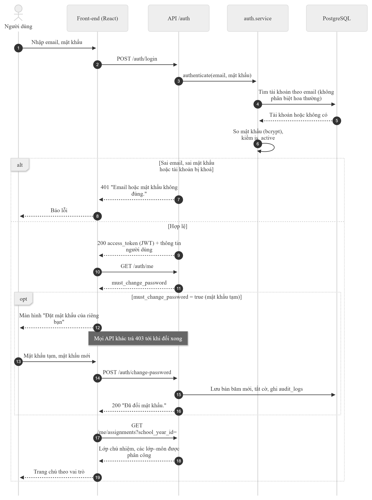

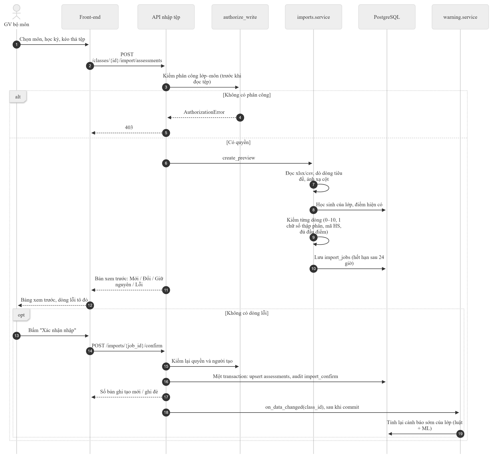

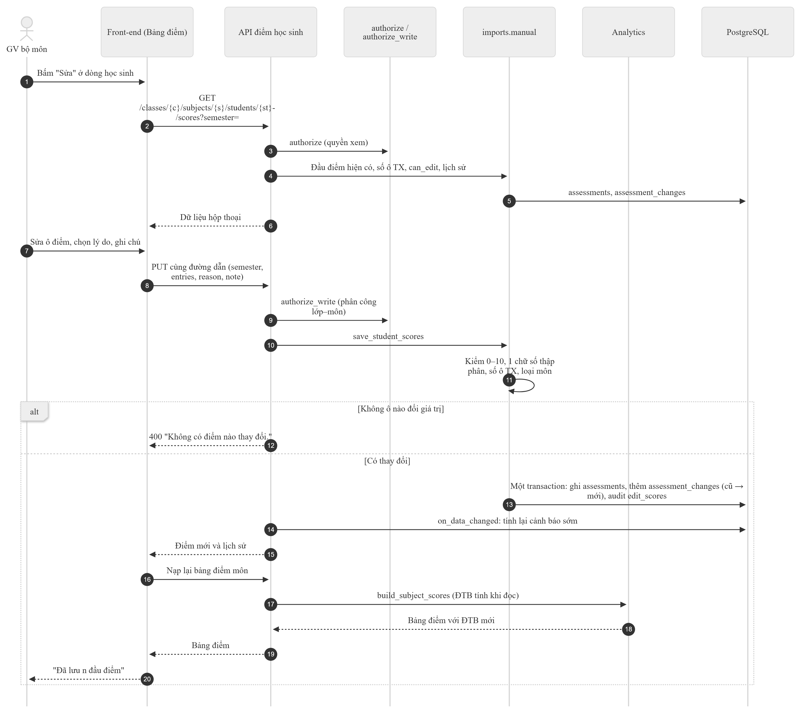

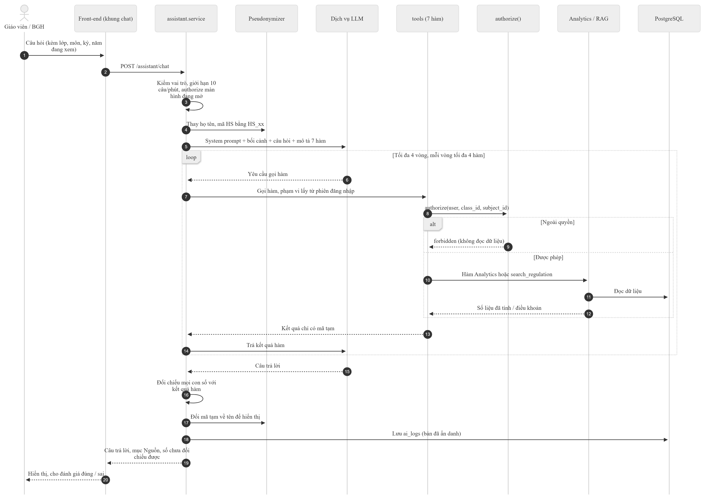

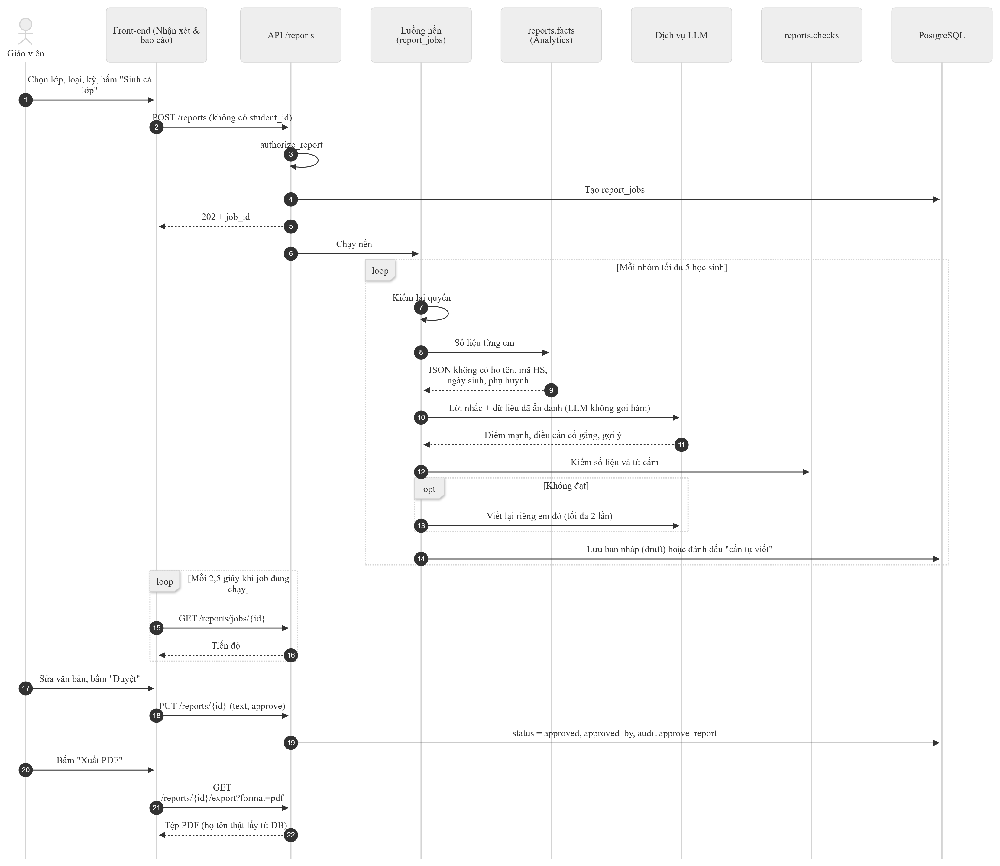

### 6.2 Sơ đồ hoạt động

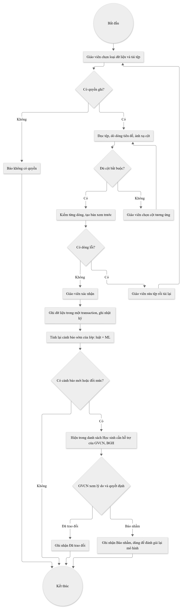

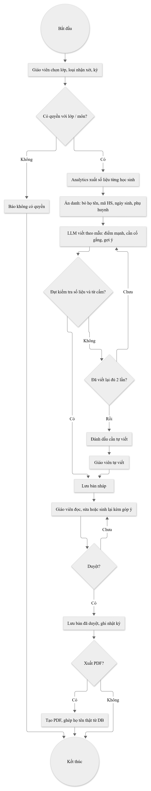

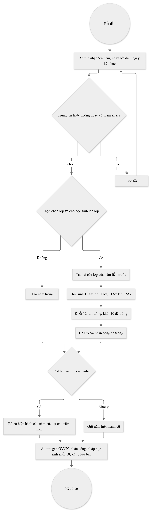

### 6.3 Sơ đồ trạng thái

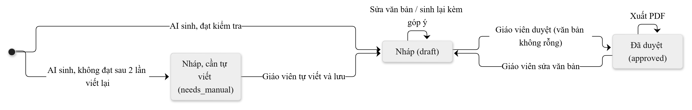

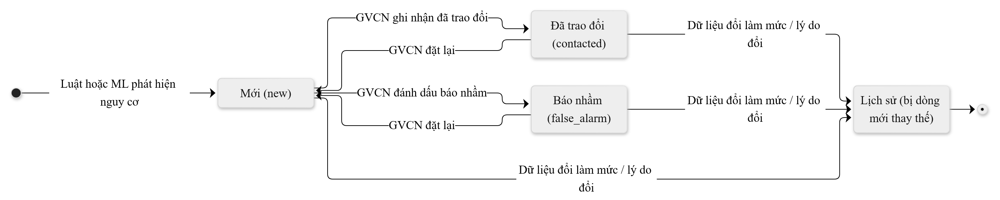

---

## 7. Yêu cầu dữ liệu

### 7.1 Mô hình dữ liệu

15 bảng nghiệp vụ theo DESIGN mục 5, cộng 8 bảng hỗ trợ:

| Nhóm | Bảng |
| --- | --- |
| Cơ cấu trường | `users` (thêm `is_active`, `specialty_subject_id`, `note`, `must_change_password`), `school_years` (thêm `is_current`), `classes`, `students`, `class_students`, `subjects`, `teaching_assignments` |
| Học vụ | `assessments`, `attendance`, `conduct_results`, `exam_registrations` |
| AI | `risk_alerts`, `reports` (thêm `school_year_id`, `class_id`, `subject_id`, `semester`…), `regulation_chunks`, `ai_logs` |
| Hỗ trợ | `settings`, `audit_logs`, `import_jobs`, `import_mappings`, `user_import_jobs`, `regulation_documents`, `report_jobs`, `assessment_changes` |

Ràng buộc chính:

- Cột liệt kê lưu mã tiếng Anh kèm `CHECK`; nhãn tiếng Việt ở `core/labels.py` (D-025).
- Điểm lưu `NUMERIC`, mỗi đầu điểm một dòng (BR-28).
- ĐTB **không lưu**: tính khi đọc (view `v_subject_average` và `analytics/`).
- Mọi thay đổi schema qua Alembic; hiện có 17 migration (mới nhất `a8c3e5f1d9b7`).

### 7.2 Cấu hình nghiệp vụ (bảng `settings`)

| Khoá | Giá trị mặc định | Ý nghĩa |
| --- | --- | --- |
| `coef_midterm`, `coef_final` | 2, 3 | Hệ số giữa kỳ, cuối kỳ trong ĐTBmhk |
| `coef_year_semester2` | 2 | Hệ số ĐTBmhk II trong ĐTBmcn |
| `score_threshold_fail` / `pass` / `fair` / `good` | 3,5 / 5,0 / 6,5 / 8,0 | Các mốc điểm |
| `level_min_subjects` | 6 | Số môn tối thiểu đạt mốc khi xét mức |
| `level_single_subject_adjustment` | bật | Nâng một mức khi chỉ do một môn |
| `max_absent_sessions` | 45 | Nghỉ quá mức này không đủ điều kiện lên lớp |
| `absent_warning_notice`, `absent_warning_high` | 30, 40 | Ngưỡng nhắc và cảnh báo cao về nghỉ |
| `regular_assessment_count` | ≤ 35 tiết: 2; ≤ 70 tiết: 3; còn lại: 4 | Số đầu điểm thường xuyên theo số tiết |
| `rag_min_similarity` | 0,56 | Ngưỡng tương đồng tối thiểu của RAG |

Cấu hình môi trường (tệp `.env`, mẫu ở `.env.example`): `APP_ENV`, `POSTGRES_USER`, `POSTGRES_PASSWORD`, `POSTGRES_DB`, `DATABASE_URL`, `JWT_SECRET`, `JWT_EXPIRE_MINUTES`, `LLM_PROVIDER`, `LLM_API_KEY`, `LLM_MODEL`, `OLLAMA_URL`, `LLM_TIMEOUT_SECONDS`, `ASSISTANT_RATE_PER_MINUTE`, `SCHOOL_NAME`, `EMBEDDING_MODEL`, `EMBEDDING_DIM`. Mật khẩu và khoá API chỉ nằm trong `.env`, không commit.

### 7.3 Định dạng tệp nhập

Quy định chung: `.xlsx` hoặc `.csv` UTF-8; tối đa 5 MB, 20.000 dòng, 60 cột; chỉ đọc trang tính đầu; dòng tiêu đề tự dò trong 15 dòng đầu; tên cột khớp bí danh, không phân biệt hoa thường và dấu cách.

| Loại tệp | Người nhập | Cột bắt buộc | Cột tuỳ chọn | Ghi chú |
| --- | --- | --- | --- | --- |
| Điểm | GVBM đúng lớp–môn | Mã HS; TX1…TXn, Giữa kỳ, Cuối kỳ (môn nhận xét: Nhận xét) | Họ và tên (để đối chiếu) | Một lớp, một môn, một học kỳ mỗi tệp; n theo BR-04 |
| Điểm danh | GVCN | Mã HS, Ngày, Trạng thái | – | Dạng dài, một dòng một buổi; ngày trong năm học (BR-30) |
| Rèn luyện | GVCN | Mã HS, Mức | Nhận xét | Chọn kỳ HK1 / HK2 / cả năm khi tải |
| Danh sách học sinh | Admin | Mã HS, Họ và tên | Ngày sinh, Phụ huynh, Số điện thoại | Mỗi em một lớp mỗi năm (BR-29) |
| Giáo viên | Admin | Họ và tên, Email | Vai trò, Bộ môn, Ghi chú | Vai trò nhận "Giáo viên Toán", "GV Ngữ văn", "Ban giám hiệu"…; chỉ tạo mới |

Tệp mẫu đúng và có lỗi nằm ở `data/samples/`.

### 7.4 Dữ liệu mẫu

- `make seed`: một trường giả lập (mặc định một năm, mỗi khối nhiều lớp, có học sinh "nhân vật" và học sinh biên để kiểm luật).
- `data/samples/`: tệp mẫu điểm (đúng và có lỗi), điểm danh, danh sách học sinh, danh sách giáo viên, `12-lop.xlsx` (đủ giáo viên 17 môn cho 12 lớp mỗi khối), `diem-30-lop/` (30 lớp × 40 học sinh × 12 môn × 2 học kỳ) và script nạp `load_diem_30_lop.py`.

### 7.5 Nhật ký và lưu giữ

| Dữ liệu | Nội dung lưu | Không lưu |
| --- | --- | --- |
| `audit_logs` | Người, thao tác (`view_class_dashboard`, `view_subject_scores`, `view_student_profile`, `edit_scores`, `import_confirm`, `update_alert`, thao tác quản trị…), đối tượng, thời điểm | Tên học sinh, văn bản nhận xét, mật khẩu |
| `ai_logs` | Câu hỏi và câu trả lời đã ẩn danh, hàm đã gọi, thời gian, mô hình, phiên bản prompt, đánh giá của người hỏi | Họ tên, mã HS thật |
| `assessment_changes` | Lịch sử sửa tay điểm: cũ → mới, lý do, ghi chú, người sửa, thời điểm | – |
| `import_jobs`, `user_import_jobs` | Bản xem trước chờ xác nhận | Bản xem trước quá 24 giờ bị dọn; dữ liệu dòng của tệp danh sách học sinh và tệp giáo viên bị xoá ngay sau khi xác nhận (D-100) |

### 7.6 Sơ đồ thực thể – liên kết (ERD)

Các bảng nghiệp vụ và quan hệ chính (chỉ ghi các cột quan trọng). Các bảng hỗ trợ `settings`, `import_jobs`, `import_mappings`, `user_import_jobs`, `report_jobs` không vẽ để sơ đồ gọn.

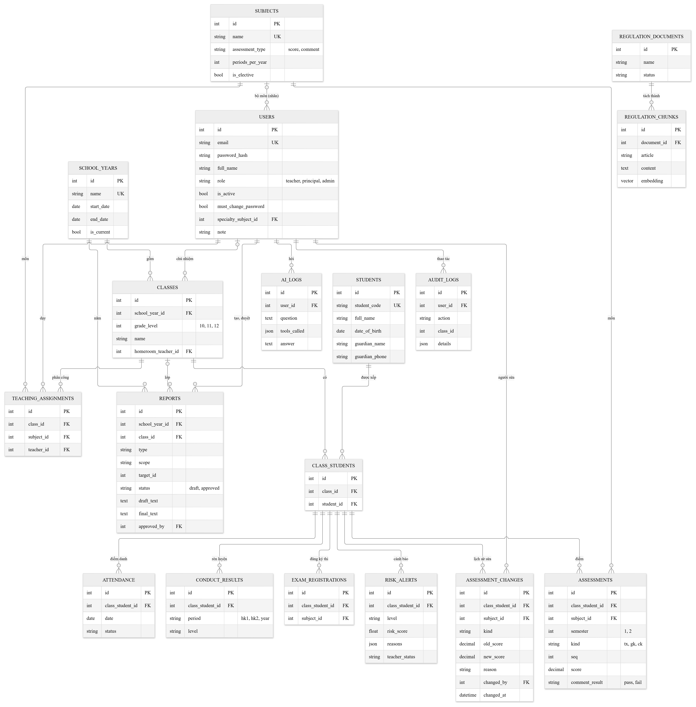

---

## 8. Yêu cầu giao diện ngoài

### 8.1 Giao diện người dùng

Tiếng Việt, số kiểu Việt Nam (`6,5`), thanh bên theo vai trò (thu gọn được, ngăn kéo trên màn hình hẹp), chế độ sáng / tối, ô chọn năm học trên thanh trên cùng.

| Màn hình | Đường dẫn | Người dùng |
| --- | --- | --- |
| Đăng nhập; đặt mật khẩu mới (khi dùng mật khẩu tạm) | `/login` | Tất cả |
| Trang chủ theo vai trò | `/` | Tất cả |
| Dashboard lớp | `/classes/:classId` | GVCN, BGH |
| Bảng điểm môn (lọc, sửa, lịch sử) | `/classes/:classId/subjects/:subjectId` | GVBM, GVCN, BGH |
| Hồ sơ học sinh | `/classes/:classId/students/:studentId` | GVBM (môn mình), GVCN, BGH |
| Nhập dữ liệu (kéo thả → chọn cột → xem trước → xác nhận) | `/classes/:classId/import` | GVBM, GVCN |
| So sánh khối | `/grades/:level` | BGH |
| Trợ lý AI | `/assistant` và khung chat nổi | Giáo viên, BGH |
| Nhận xét & báo cáo | `/reports` | Giáo viên, BGH |
| Đổi mật khẩu | `/account/password` | Tất cả |
| Tài khoản | `/admin/users` | Admin |
| Năm học & lớp | `/admin/school` | Admin |
| Lớp (phân công, danh sách học sinh) | `/admin/classes/:classId` | Admin |
| Văn bản quy định | `/admin/regulations` | Admin |
| Trang không tồn tại | `*` | Tất cả |

### 8.2 Giao diện lập trình

REST, tiền tố `/api/v1`, xác thực JWT Bearer. Swagger tự sinh tại `/docs` (tắt khi `APP_ENV=production`). Bảng dưới liệt kê đủ 52 endpoint trong 12 router FastAPI.

| Method | Đường dẫn | Vai trò | Mô tả |
| --- | --- | --- | --- |
| GET | `/health` | Công khai | Tình trạng hệ thống và kết nối DB |
| POST | `/auth/login` | Công khai | Đăng nhập, trả JWT |
| GET | `/auth/me` | Đã đăng nhập (kể cả đang dùng mật khẩu tạm) | Thông tin tài khoản của chính mình |
| POST | `/auth/change-password` | Đã đăng nhập (kể cả đang dùng mật khẩu tạm) | Đổi mật khẩu của chính mình |
| GET | `/me/assignments` | Đã đăng nhập | Lớp chủ nhiệm và lớp–môn được phân công của tôi |
| GET | `/school-years` | Đã đăng nhập | Các năm học, mới nhất trước |
| GET | `/classes/{class_id}/students` | Có quyền với lớp | Danh sách học sinh của lớp |
| GET | `/classes/{class_id}/dashboard` | GVCN của lớp, BGH | Dashboard lớp theo kỳ |
| GET | `/classes/{class_id}/subjects/{subject_id}/scores` | GVBM đúng môn, GVCN, BGH | Bảng điểm một môn của lớp |
| GET | `/classes/{class_id}/students/{student_id}/profile` | GVBM (môn mình), GVCN, BGH | Hồ sơ học sinh |
| GET | `/grades/{level}/overview` | BGH | So sánh các lớp trong một khối, HK I và II |
| POST | `/classes/{class_id}/import/{kind}` | GVBM (`assessments`), GVCN (`attendance`, `conduct`), Admin (`roster`) | Tải tệp và xem trước |
| POST | `/imports/{job_id}/confirm` | Người tạo bản xem trước | Xác nhận, ghi trong một transaction |
| GET | `/imports/mappings` | Đã đăng nhập | Các mẫu ánh xạ cột đã lưu của tôi |
| GET | `/classes/{class_id}/subjects/{subject_id}/students/{student_id}/scores` | GVBM đúng môn, GVCN, BGH | Điểm một học kỳ và lịch sử sửa điểm của một học sinh |
| PUT | `/classes/{class_id}/subjects/{subject_id}/students/{student_id}/scores` | GVBM đúng lớp–môn | Sửa / nhập tay điểm kèm lý do |
| GET | `/classes/{class_id}/alerts` | GVCN của lớp, BGH | Cảnh báo sớm của lớp |
| GET | `/alerts` | BGH | Cảnh báo toàn trường theo mức và năm học |
| PATCH | `/alerts/{alert_id}` | GVCN của lớp | Ghi nhận "đã trao đổi" / "báo nhầm" / "mới" |
| GET | `/regulations/search` | Đã đăng nhập | Tìm đoạn văn bản quy định còn hiệu lực |
| GET | `/admin/regulations` | Admin | Danh sách văn bản quy định |
| POST | `/admin/regulations` | Admin | Tải văn bản (.pdf, .docx, .txt), tách Điều/Khoản |
| PATCH | `/admin/regulations/{document_id}` | Admin | Đánh dấu hết hiệu lực hoặc bật lại |
| POST | `/assistant/chat` | Giáo viên, BGH | Hỏi trợ lý AI, trả câu trả lời kèm nguồn |
| PATCH | `/assistant/logs/{log_id}/feedback` | Người đã hỏi | Đánh giá câu trả lời đúng / sai |
| POST | `/reports` | GVBM, GVCN, BGH theo loại | Sinh bản nháp một em / một báo cáo (201) hoặc cả lớp chạy nền (202) |
| GET | `/reports` | Theo quyền với lớp / khối | Danh sách nhận xét của một lớp, báo cáo lớp / khối |
| GET | `/reports/jobs/{job_id}` | Theo quyền với lớp | Tiến độ một lần sinh cả lớp |
| PUT | `/reports/{report_id}` | Người có quyền với bản đó | Sửa văn bản và / hoặc duyệt |
| POST | `/reports/{report_id}/regenerate` | Người có quyền với bản đó | Sinh lại bản nháp, có thể kèm góp ý |
| GET | `/reports/{report_id}/export` | Người có quyền với bản đó | Xuất PDF bản đã duyệt (bản nháp: 409) |
| GET | `/admin/users` | Admin | Danh sách tài khoản |
| POST | `/admin/users` | Admin | Tạo tài khoản, trả mật khẩu tạm một lần |
| PATCH | `/admin/users/{user_id}` | Admin | Sửa tên, email, vai trò, khoá / mở khoá |
| POST | `/admin/users/{user_id}/reset-password` | Admin | Đặt lại mật khẩu, trả mật khẩu tạm một lần |
| POST | `/admin/users/import` | Admin | Tải tệp giáo viên và xem trước |
| POST | `/admin/users/import/{job_id}/confirm` | Admin | Xác nhận, tạo tài khoản, trả mật khẩu tạm một lần |
| GET | `/admin/school` | Admin | Năm học và các lớp |
| GET | `/admin/teachers` | Admin | Giáo viên đang hoạt động, để chọn GVCN hoặc người dạy |
| GET | `/admin/subjects` | Admin | 17 môn GDPT 2018 |
| PUT | `/admin/school-year` | Admin | Tạo năm học đầu tiên hoặc sửa năm hiện hành |
| POST | `/admin/school-years` | Admin | Tạo năm học mới, có thể chép lớp và lên lớp |
| PATCH | `/admin/school-years/{year_id}` | Admin | Sửa tên, ngày của một năm học |
| POST | `/admin/school-years/{year_id}/current` | Admin | Đặt năm hiện hành |
| POST | `/admin/classes` | Admin | Tạo lớp trong năm học |
| PATCH | `/admin/classes/{class_id}` | Admin | Đổi tên lớp hoặc GVCN |
| DELETE | `/admin/classes/{class_id}` | Admin | Xoá lớp đã trống |
| GET | `/admin/classes/{class_id}/assignments` | Admin | Môn học của lớp và giáo viên phụ trách |
| PUT | `/admin/classes/{class_id}/assignments/{subject_id}` | Admin | Gán hoặc đổi giáo viên của một cặp lớp–môn |
| DELETE | `/admin/classes/{class_id}/assignments/{subject_id}` | Admin | Gỡ phân công khi lớp chưa có điểm môn đó |
| POST | `/admin/classes/{class_id}/assignments/copy` | Admin | Sao chép phân công còn trống từ lớp cùng khối |
| POST | `/admin/classes/{class_id}/students/remove` | Admin | Gỡ học sinh (theo mã) khi em chưa có dữ liệu |

Quy ước mã lỗi: 401 chưa đăng nhập; 403 không có quyền (hoặc đang dùng mật khẩu tạm); 404 không có đối tượng; 409 xung đột; 410 bản xem trước hết hạn; 413 / 415 tệp quá lớn / sai định dạng; 422 dữ liệu không hợp lệ; 429 vượt giới hạn; 502 / 503 lỗi hoặc chưa cấu hình LLM. Thông điệp lỗi bằng tiếng Việt.

### 8.3 Dịch vụ bên ngoài

| Dịch vụ | Cấu hình | Dữ liệu gửi đi | Ghi chú |
| --- | --- | --- | --- |
| LLM | `LLM_PROVIDER`, `LLM_API_KEY`, `LLM_MODEL`, `OLLAMA_URL`, `LLM_TIMEOUT_SECONDS` | Câu hỏi và kết quả hàm đã ẩn danh (mã `HS_xx`); số liệu Analytics không có họ tên, mã HS, ngày sinh, phụ huynh | Anthropic (mặc định `claude-sonnet-5-5`), Gemini (mặc định `gemini-flash-latest`), Ollama chạy nội bộ (mô hình 7–8B có gọi hàm) |
| Mô hình embedding | `EMBEDDING_MODEL` (mặc định `BAAI/bge-m3`) | Không gửi gì: chạy trên máy chủ | Tải một lần vào volume `hf_cache` |

---

## 9. Yêu cầu phi chức năng

| Mã | Loại | Yêu cầu và chỉ số đo | Trạng thái | Bằng chứng |
| --- | --- | --- | --- | --- |
| NFR-01 | Chính xác | ĐTB, mức học tập, điều kiện lên lớp khớp 100% với cách tính tay | ✅ | 30 ca tính tay `eval/analytics_cases.json`, 30/30 khớp; thử "đột biến" công thức đều làm test đỏ (D-054) |
| NFR-02 | Chính xác AI | 100% con số AI nói ra đến từ hàm Analytics | ✅ | Kiểm số sau trả lời: trợ lý hiện cảnh báo, nhận xét bị chặn (D-090, D-105) |
| NFR-03 | Hiệu năng | Dashboard trường dưới 3 giây; câu trả lời AI dưới 10 giây (trường 36 lớp, khoảng 1.500 học sinh) | 🟡 | Dashboard lớp 40 em khoảng 26–62 ms, tổng quan khối 120 em khoảng 79 ms (ước khoảng 1 giây cho 1.500 em, chưa đo ở quy mô đó) (D-052); thời gian AI phụ thuộc nhà cung cấp |
| NFR-04 | Bảo mật | Mỗi người chỉ thấy dữ liệu theo vai trò, phân công, năm học, kể cả qua chatbot | ✅ | Test phân quyền cho cả 4 vai trò và chưa đăng nhập ở mỗi endpoint; prompt injection bị chặn bằng thiết kế 7 hàm (D-087) |
| NFR-05 | Bảo mật | Mật khẩu băm bcrypt; khoá API chỉ trong `.env`; bắt đổi mật khẩu tạm; giới hạn câu hỏi AI; nhật ký truy cập hồ sơ; HTTPS khi triển khai | 🟡 | Phần ứng dụng đã làm; HTTPS và reverse proxy giới hạn dung lượng tải lên thuộc Giai đoạn 11, chưa làm |
| NFR-06 | Quyền riêng tư | Không gửi LLM họ tên, mã HS, ngày sinh, thông tin phụ huynh | ✅ | Ẩn danh và `assert_safe` trước mỗi lần gọi; test quét `core/test_pseudonymize.py` (D-086, D-106) |
| NFR-07 | Minh bạch | 100% cảnh báo có lý do; 100% câu trả lời AI có mục Nguồn | ✅ | D-071, D-089; `warning/test_rules.py`, `assistant/test_service.py` |
| NFR-08 | Đạo đức AI | Nhận xét tích cực, không gắn nhãn, không so sánh, không nhắc hoàn cảnh gia đình; giáo viên duyệt trước khi dùng | ✅ | Danh sách từ cấm `reports/banned_words.txt` và bắt duyệt (D-105) |
| NFR-09 | Khả dụng | Giao diện tiếng Việt, dùng được ở khổ 390 px, có chế độ tối, đạt tương phản | 🟡 | Đã soát trên Chrome; chưa thử trình duyệt khác và trình đọc màn hình |
| NFR-10 | Triển khai | Chạy bằng một lệnh `make up` (Docker Compose), không cần GPU | ✅ | `docker-compose.yml`, `Makefile` |
| NFR-11 | Bảo trì | ruff, eslint, `tsc -b` qua; type hints đầy đủ; Conventional Commits; CI GitHub Actions chạy lint và test | ✅ | 1.590 test back-end qua, 1 bỏ qua (cần tải mô hình thật), theo lần chạy ghi ở PROGRESS.md ngày 04/11/2026; front-end chưa có test tự động (D-069) |

---

## 10. Ma trận truy vết

### 10.1 Chức năng DESIGN → yêu cầu

| DESIGN | Ưu tiên | Chức năng | Yêu cầu | Quy tắc | Use case | Trạng thái |
| --- | --- | --- | --- | --- | --- | --- |
| F1 | Phải có | Đăng nhập, phân quyền | FR-AUTH-01…06 | – | UC01 | ✅ |
| F2 | Phải có | Năm học, lớp, học sinh, môn, phân công | FR-ADM-01…11, FR-YEAR-01…03 | BR-29, BR-30 | UC02, UC12…UC14 | ✅ (danh mục môn chỉ đọc) |
| F3 | Phải có | Nhập điểm, điểm danh, rèn luyện | FR-IMP-01…07, FR-SCORE-01…04 | BR-27, BR-28 | UC03, UC04, UC06 | ✅ |
| F4 | Phải có | Tính theo Thông tư 22 | FR-ANA-01…05 | BR-01…BR-14 | UC05, UC07 | ✅ (cần đối chiếu văn bản gốc) |
| F5 | Phải có | Dashboard lớp, môn, khối | FR-ANA-06…09, FR-ANA-11 | – | UC05, UC07 | 🟡 (FR-ANA-11 chưa làm) |
| F6 | Phải có | Cảnh báo sớm | FR-WARN-01…05 | BR-15…BR-26 | UC08 | ✅ |
| F7 | Phải có | Hỏi dữ liệu tiếng Việt | FR-AI-01…06 | BR-31 | UC09 | ✅ |
| F8 | Phải có | Hỏi đáp quy định có trích điều khoản | FR-RAG-01…03, FR-ADM-10, FR-AI-02 | BR-32 | UC09, UC15 | 🟡 (ngưỡng, văn bản thật) |
| F9 | Phải có | Sinh nhận xét, báo cáo; sửa và duyệt | FR-RPT-01…05 | – | UC10 | ✅ |
| F10 | Nên có | Theo dõi khối 12, môn thi tốt nghiệp | FR-WARN-01, FR-ANA-12 | BR-24 | UC08 | 🟡 (chưa có màn hình riêng) |
| F11 | Nên có | Xuất PDF / Excel | FR-RPT-06, FR-RPT-07 | – | UC10 | 🟡 (PDF có, Excel không) |
| F12 | Nếu còn thời gian | So sánh lớp trong khối, HK I và II | FR-ANA-10 | – | UC11 | ✅ |

Phần vượt DESIGN đã làm theo yêu cầu của nhóm: nhiều năm học (D-113), nhập giáo viên từ tệp (D-110), vai trò "Giáo viên <môn>" (D-112), bắt đổi mật khẩu tạm (D-114), sửa tay điểm kèm lịch sử (D-115), lọc theo khoảng điểm, so sánh khối theo mọi môn (D-116).

### 10.2 Yêu cầu phi chức năng DESIGN → NFR

| DESIGN mục 2 / mục 10 | NFR |
| --- | --- |
| Chính xác | NFR-01, NFR-02 |
| Hiệu năng | NFR-03 |
| Bảo mật | NFR-04, NFR-05 |
| Quyền riêng tư | NFR-06 |
| Minh bạch | NFR-07 |
| Đạo đức AI (mục 10) | NFR-08 |
| Không cần GPU | NFR-10 |

---

## 11. Hạn chế, chỗ lệch và vấn đề mở

### 11.1 Hạn chế đã biết và việc chưa làm

| Mục | Mô tả |
| --- | --- |
| Giai đoạn 10 – Đánh giá AI | Chưa làm đủ bộ đánh giá của DESIGN mục 12: trợ lý mới có 15 câu mẫu, RAG mới có khung 10 câu trên văn bản giả, chưa có giáo viên chấm nhận xét. |
| Giai đoạn 11 – Bảo mật, triển khai, demo | Chưa có HTTPS, reverse proxy (giới hạn dung lượng tải lên thật), image triển khai, hàng đợi riêng cho job sinh nhận xét. |
| Thông tư 22 | Quy tắc lấy từ nguồn thứ cấp; cách hiểu "nâng một mức" và "rèn luyện cả năm" cần đối chiếu văn bản gốc. |
| Dữ liệu thật | Chưa thử tệp xuất thật của sổ điểm điện tử, văn bản quy định thật; mô hình ML huấn luyện trên dữ liệu giả lập. |
| Token | Token đã cấp còn dùng được tới khi hết hạn sau khi đổi / đặt lại mật khẩu (chỉ khoá tài khoản có hiệu lực ngay). |
| Lịch sử điểm | Nhập điểm từ tệp không ghi vào lịch sử sửa điểm (chỉ có nhật ký `import_confirm`). |
| Front-end | Chưa có Vitest / Playwright trong repo; đã soát bằng Chrome thật ngoài repo. |

### 11.2 Chỗ lệch giữa DESIGN và mã nguồn

| Mục | DESIGN | Mã nguồn | Căn cứ |
| --- | --- | --- | --- |
| Phạm vi năm học | Một năm học | Nhiều năm học, một năm hiện hành, xem lại năm cũ | D-113 |
| Vai trò | Bốn vai trò GVBM, GVCN, BGH, Admin | Ba loại tài khoản; GVBM, GVCN suy ra từ phân công | D-041, D-112 |
| Bảng dữ liệu | 15 bảng (mục 5) | 15 bảng nghiệp vụ và 8 bảng hỗ trợ | Mục 7.1 |
| F5 – dashboard | Dashboard môn (GVBM), dashboard khối và trường (BGH) | Bảng điểm môn; so sánh khối và cảnh báo mức cao ở trang chủ BGH; chưa có trang tổng hợp toàn trường | FR-ANA-11 |
| F10 – khối 12 | Theo dõi môn thi tốt nghiệp, danh sách phụ đạo | Chỉ có luật cảnh báo `grade12_exam_low` | FR-ANA-12 |
| F11 – xuất tệp | PDF / Excel | Chỉ PDF | D-108 |
| Ngưỡng ở `settings` | Mọi ngưỡng Thông tư 22 đọc từ `settings` | Số môn nhận xét Chưa đạt tối đa của mức Đạt (1) là hằng `MAX_FAILED_COMMENTS_FOR_PASS` trong `analytics/learning.py`, chưa có khoá `settings` | BR-09, BR-21 |
| Ngưỡng ML | Không nêu | Ngưỡng xác suất 0,54 / 0,80 nằm trong tệp metadata của mô hình, không trong `settings` | BR-25 |

### 11.3 Vấn đề mở

| Mã | Câu hỏi cần nhóm trả lời | Ảnh hưởng | Liên quan |
| --- | --- | --- | --- |
| VĐ-01 | Ai đối chiếu Thông tư 22 bản gốc cho quy tắc "nâng một mức", rèn luyện cả năm và số đầu điểm thường xuyên theo số tiết? | Độ chính xác xếp loại và điều kiện lên lớp | BR-04, BR-10, BR-12 |
| VĐ-02 | Thiết kế tỉ lệ đạt / khá giỏi và trang tổng hợp cảnh báo cho BGH: chỉ số nào, lọc theo gì? | FR-ANA-11 còn chưa làm | F5 |
| VĐ-03 | Có cần màn hình riêng theo dõi khối 12 (môn đăng ký thi, danh sách phụ đạo) không? | FR-ANA-12 | F10 |
| VĐ-04 | Giữ quyết định không xuất Excel và không gộp nhiều phiếu một PDF, hay làm ở Giai đoạn 11? | FR-RPT-07 | F11, D-108 |
| VĐ-05 | Khi có văn bản quy định thật, ai hiệu chỉnh lại ngưỡng `rag_min_similarity`? | Tỉ lệ trả lời "không tìm thấy" sai | FR-RAG-02 |
| VĐ-06 | Có thu hồi token đang dùng khi đổi hoặc đặt lại mật khẩu không? | Bảo mật phiên | FR-AUTH-02 |
| VĐ-07 | Nhập điểm từ tệp có cần ghi lịch sử từng đầu điểm như sửa tay không? | Truy vết thay đổi điểm | FR-IMP-06, FR-SCORE-03 |
| VĐ-08 | Có đưa số môn nhận xét Chưa đạt tối đa và ngưỡng ML vào bảng `settings` không? | Tuân thủ nguyên tắc C2 | BR-09, BR-25 |
| VĐ-09 | Có cần chỉnh ngưỡng Thông tư 22 và danh mục môn trên giao diện Admin không? | FR-ADM-11 | F2 |
| VĐ-10 | Khi nào đo hiệu năng ở quy mô 36 lớp, khoảng 1.500 học sinh? | NFR-03 | DESIGN mục 2 |
